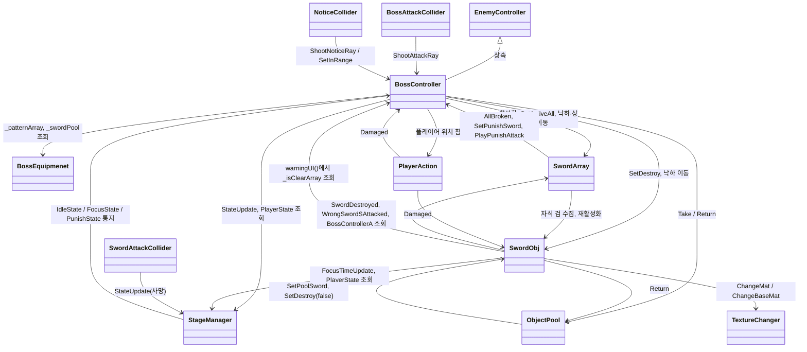
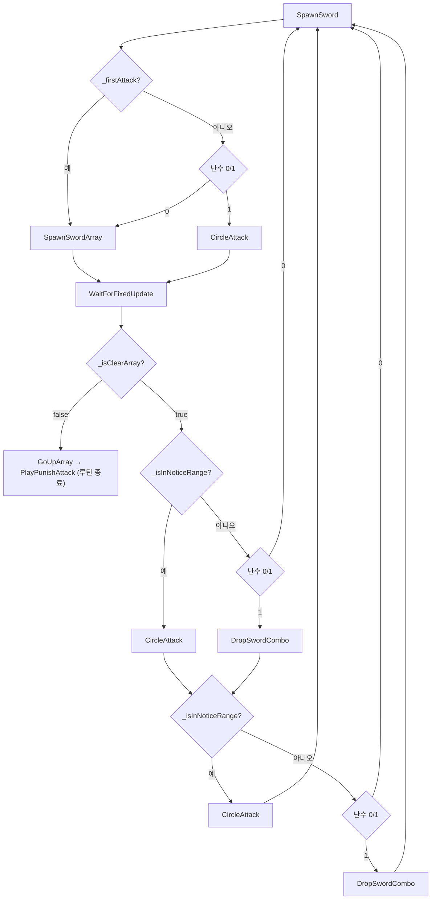

# Boss

## 기능 개요

### 기능 정의

- BossStage의 보스전을 담당하는 시스템
- 보스의 공격 패턴 선택·실행, 검 소환과 낙하, 검진(검 배열) 생성과 파훼 판정, 응징·즉사 공격, 보스 피격과 클리어 요청 담당
- 패턴용 단일 검은 오브젝트 풀로 재사용
- 게임 상태 보관과 전파는 `StageManager`([GameState](./GameState.md)), 플레이어의 공격 경로 실행과 피격 대상 판정은 `PlayerAction`([PlayerAttack](./PlayerAttack.md)), 적 공통 구조는 `EnemyController`([Enemy](./Enemy.md))가 담당

### 주요 동작

- 게임 상태가 `기본`이 되면 하나의 메인 코루틴(`PatternRoutine`)이 시작되고, 하위 패턴 코루틴을 `yield return StartCoroutine()`으로 순서대로 실행
- 패턴 4종
    - 검 소환 + 돌진 : 플레이어 뒤쪽 상공에 풀 검 1개를 떨어뜨린 뒤, 보스가 검 위치로 순간 이동. 이동 경로에 플레이어가 있으면 `사망`
    - 검진 : 미리 배치된 검 배열 3종 중 하나를 보스 위에서 떨어뜨리고, 제한 시간 동안 플레이어가 파괴 가능한 검을 모두 부수면 파훼
    - 범위 공격 : 원형 표시 후 보스 주변 구형 트리거를 잠시 켜서, 범위 안의 플레이어를 `사망` 처리
    - 연속 검 낙하 : 플레이어 바로 위에 파괴 가능한 풀 검을 3회 연속으로 떨어뜨림
- 후속 패턴은 첫 공격 여부, 난수, 검진 파훼 성공 여부, 플레이어의 감지 범위 진입 여부로 결정
- 검진 파훼 실패 시 검진을 들어 올리고 플레이어 위치에 다른 검진을 떨어뜨린 뒤 응징 공격으로 `사망` 처리
- 검진 안의 파괴 불가 검을 공격하면 즉시 응징 공격으로 `사망` 처리
- 플레이어가 `집중` 상태를 일정 시간 이상 유지하면 응징 공격으로 `사망` 처리
- 대부분의 패턴 대기·낙하 시간은 게임 상태가 `기본`일 때만 진행되어, `집중`·`공격` 중에는 패턴이 멈췄다가 이어서 진행
- 파괴 가능한 검을 부수면 플레이어의 집중 시간을 회복
- 보스의 생명이 0 이하가 되면 `클리어` 상태를 요청하고 보스 오브젝트를 파괴

### 클래스 설명

- `BossController` (`Assets/Scripts/Enemy/BossController.cs`):
    - `EnemyController`를 상속한 보스 본체
    - 패턴 루틴, 패턴별 공격 판정, 응징·즉사 공격, 보스 모델 전환, 피격·클리어 처리
- `SwordArray` (`Assets/Scripts/Enemy/SwordArray.cs`):
    - 검진 하나(자식 `SwordObj` 묶음)를 관리
    - 파괴 가능한 검 수를 세고, 모두 파괴되면 보스에 파훼를 통지, 파괴 불가 검이 공격되면 응징을 요청
- `BossAttackCollider` (`Assets/Scripts/Enemy/BossAttackCollider.cs`):
    - 범위 공격용 구형 트리거. 플레이어 진입 시 보스에 공격을 통지
- `SwordAttackCollider` (`Assets/Scripts/Enemy/SwordAttackCollider.cs`):
    - 검에 붙는 박스 트리거. 플레이어 진입 시 `사망` 상태 요청
- `SwordObj` (`Assets/Scripts/SwordObj.cs`):
    - 검 하나의 파괴 가능 여부, 레이어·머티리얼 전환, 낙하 경고 표시, 피격 처리
    - 검진의 자식 검과 오브젝트 풀의 검이 같은 클래스를 사용
- `ObjectPool` (`Assets/Scripts/ObjectPool.cs`):
    - 검 프리팹을 미리 생성해 두고 꺼내기(`Take`)·반환(`Return`)을 제공하는 싱글톤

- 다른 시스템 소속이거나 이 문서의 대상 목록 밖이지만 보스 동작에 관여하는 클래스
    - `EnemyController` (`Assets/Scripts/Enemy/EnemyController.cs`) : 적 공통 추상 클래스. `StageManager` 구독·해제와 상태별 메서드 골격 제공 ([Enemy](./Enemy.md))
    - `BossEquipmenet` (`Assets/Scripts/Enemy/BossEquipmenet.cs`) : 보스에 붙어 검진 목록(`_patternArray`)과 오브젝트 풀 참조(`_swordPool`)를 보관하는 데이터 컴포넌트
    - `TextureChanger` (`Assets/Scripts/TextureChanger.cs`) : `SwordObj`가 검의 머티리얼을 바꿀 때 사용
    - `NoticeCollider` (`Assets/Scripts/Enemy/NoticeCollider.cs`) : 플레이어의 감지 범위 진입·이탈을 보스에 통지 ([Enemy](./Enemy.md))
    - `StageManager` (`Assets/Scripts/StageManager.cs`) : 게임 상태 보관·전파, 집중 시간 회복 전달 ([GameState](./GameState.md))
    - `PlayerAction` (`Assets/Scripts/Player/PlayerAction.cs`) : 플레이어 공격 경로 실행. 경로상의 보스·검에 `IDamageable.Damaged()` 호출 ([PlayerAttack](./PlayerAttack.md))

## 클래스 설계 및 구조

#### `BossController`

- 형태 : `EnemyController`(추상 `MonoBehaviour`, `IDamageable`, `IStateObserver`)를 상속
- 직렬화 필드
    - `_life` : 보스 생명. `Damaged()` 호출 1회당 1 감소. `PlayerAction.Attack()`은 경로 구간마다 SphereCastAll을 수행하고 맞은 콜라이더마다 `Damaged()`를 호출하므로, 한 번의 공격에서 여러 구간에 걸쳐 맞으면 여러 번 감소
    - `_dropSwordTime` : 검·검진이 낙하(또는 상승)하는 시간
    - `_player` : 플레이어(`PlayerAction`) 참조. `SpawnSword`, `DropSwordCombo`, `GoUpArray`, `PunishTerm`, `LookPlayer`의 플레이어 위치 기준. `Boss.prefab`에서는 비어 있고 BossStage에서 지정
    - `_swordSpawnHeight` : 검·검진의 생성 높이
    - `_playerLayer` : 돌진·응징 판정용 Raycast/SphereCast 대상 레이어
    - `FocusCoolTime` : `집중` 상태 유지 허용 시간. 초과 시 즉사 공격
    - `_swordArrayTime` : 검진 파훼 제한 시간
    - `_isInNoticeRange` : 플레이어가 감지 범위 안에 있는지 여부. `NoticeCollider`가 갱신
    - `_circleCollider` : 범위 공격 판정용 콜라이더. `BossAttackCollider`가 붙은 오브젝트의 `SphereCollider`를 참조
    - `_circleLine` : 범위 공격 예고용 원형 라인(`LineRendererPolygon`)
    - `_default`, `_attack1`, `_attack2`, `_attack3`, `_arrayReady` : 패턴별로 하나만 켜지는 보스 모델 오브젝트
- 에디터 설정값 (`Assets/Prefab/Boss.prefab` 기본값, `Assets/Scenes/BossStage.unity`에서 덮어쓴 값은 괄호)
    - `_life` 15 (20), `_dropSwordTime` 0.4, `_swordSpawnHeight` 20, `FocusCoolTime` 4 (3.5), `_swordArrayTime` 4 (3.5), `_noticeRange` 10, 범위 공격 `SphereCollider` 반지름 10
- 상태 필드
    - `_canSummonSword` : 검 소환 패턴 진행 중 재진입 방지
    - `_canSummonSwordArray` : 검진이 없거나 파훼된 상태면 `true`. 검진 생성 시 `false`, `AllBroken()`에서 `true`
    - `_isClearArray` (public get) : 검진 파훼에 실패하지 않은 상태면 `true`. 파훼 실패 시에만 `false`가 되며, 다시 `true`로 되돌리는 곳은 `CacheComponents()`뿐
    - `_firstAttack` : 첫 루프 여부. 첫 루프에서는 반드시 검진 패턴 실행
    - `_currentArray` : 현재 활성화된 검진
    - `_punishSword` : 응징 공격 시 비활성화할 검
    - `_mainPattern`, `_focusTimer` : 실행 중인 메인 패턴·집중 타이머 코루틴 핸들
- 프로퍼티
    - `_equipment` : `GetComponent<BossEquipmenet>()`를 접근할 때마다 호출하는 식 본문 프로퍼티
- 메서드 (상태 통지 : `StageManager`가 호출)
    - `IdleState()` : `_mainPattern`이 없을 때만 `PatternRoutine()` 시작. 이미 실행 중이면 무시하므로 `기본` 상태가 반복 통지되어도 패턴이 처음부터 다시 시작되지 않음
    - `FocusState()` : 기존 `FocusTimer()`를 멈추고 새로 시작
    - `PunishState()` : 검진이 활성 상태이고(`!_canSummonSwordArray`) 파훼 실패가 아닐 때(`_isClearArray`)만 동작
        1. 현재 검진의 활성 검마다 보스 위치에서 검 방향으로 SphereCast(반지름 0.4)를 쏘고, 플레이어가 맞으면 그 검을 `_punishSword`로 지정한 뒤 `PunishAttack()`
        2. 이어서 오브젝트 풀(`_equipment._swordPool`)의 활성 자식에 대해 같은 판정을 하고, 맞으면 `_currentArray.Sword[i]`를 `_punishSword`로 지정한 뒤 `PunishAttack()`
        - 위 조건에 해당하지 않으면 `응징` 상태가 되어도 보스는 아무 공격도 하지 않음
        - `PlayPunishAttack()`이 아니라 `PunishAttack()`을 직접 호출하므로, 이 경로에서는 `_mainPattern`을 멈추지 않음
    - `AttackState()`, `DeadState()`, `ClearState()` : 빈 구현
- 메서드 (외부 호출)
    - `Damaged()` : `_life`를 1 감소. 0 이하이면 `StateUpdate(클리어)` 후 `Destroy(gameObject)`
    - `ShootNoticeRay()` : Ray를 쏘지 않고 `SetInRange(true)`만 호출 (부모의 추상 메서드명을 따름)
    - `SetInRange(bool)` (override) : `_isInNoticeRange` 갱신. `NoticeCollider.OnTriggerExit()`가 `SetInRange(false)`로 감지 범위 이탈을 통지
    - `ShootAttackRay()` : Ray를 쏘지 않고 즉시 `StateUpdate(사망)` 호출. `BossAttackCollider`가 호출
    - `SetPunishSword(SwordObj)` : 응징 시 비활성화할 검 지정. 지정 후 비우는 코드는 없음
    - `PlayPunishAttack()` : `_mainPattern`을 `StopCoroutine`으로 멈춘 뒤 `PunishAttack()` 호출
    - `AllBroken()` : `_canSummonSwordArray = true`, 현재 검진 비활성화 후 `_currentArray = null`. `SwordArray`가 호출
- 메서드 (내부)
    - `PunishAttack()` (protected override) : `StateUpdate(사망)` 후 `PunishTerm()` 시작
        - `PunishTerm()` : 호출 시점의 보스→플레이어 방향을 저장하고 `WaitForSeconds(0.5f)` 대기 → 모델 1로 전환, 플레이어 위치에서 그 방향으로 2만큼 지난 지점으로 순간 이동, `_punishSword` 비활성화
    - `PatternRoutine()` : 패턴 선택과 순서를 관리하는 무한 루프. 흐름은 `실행 절차 흐름` 참고
    - `SpawnSword()` / `DashAttack(GameObject)` : 검 소환 + 돌진 패턴
    - `SpawnSwordArray()` / `CastingAttack()` : 검진 생성과 파훼 대기
    - `GoUpArray(SwordArray)` : 검진 파훼 실패 후 처리
    - `DropSwordCombo()` : 연속 검 낙하 패턴
    - `CircleAttack()` : 범위 공격 패턴
    - `DropSword(SwordArray)` / `DropSword(SwordObj)` : 검진·단일 검 낙하 오버로드
        - 공통 : `기본` 상태에서만 0.5초 대기 → `기본` 상태에서만 `_dropSwordTime` 동안 y를 0으로 이동 → y = 0 확정
        - `SwordArray` 버전은 모델 4로 전환하고, 낙하 후 대기 타이머(앞의 0.5초를 이어서 사용)가 0.9가 될 때까지 추가 대기
        - `SwordObj` 버전은 모델 3으로 전환하고 추가 대기 없음
        - 보간은 `Mathf.Lerp(pos.y, 0f, t / _dropSwordTime)`로 매 프레임 갱신된 현재 높이를 시작값으로 사용
    - `ScanRoute(Vector3, out Vector3, out bool, bool CheckRay = true)` : 보스 위치(y = 1)에서 목표 지점까지 `_playerLayer` 대상으로 `CheckRay`가 `true`면 Raycast, `false`면 SphereCast(반지름 0.4)를 쏴서 플레이어 존재 여부 반환
        - `hitPosition`도 계산하지만, 현재 호출처(`DashAttack`, `PunishState`)는 사용하지 않음
    - `FocusTimer()` : 게임 상태와 무관하게 `Time.deltaTime`을 누적하되, 상태가 `집중`이 아니게 되면 즉시 종료. `FocusCoolTime`에 도달했을 때 여전히 `집중`이면 `PlayPunishAttack()`
    - `ChangeBossModel(int pattern)` : `LookPlayer()`로 플레이어를 바라본 뒤, 번호에 해당하는 모델만 활성화 (0 `_default`, 1 `_attack1`, 2 `_attack2`, 3 `_attack3`, 4 `_arrayReady`)
    - `CacheComponents()` (override) : 부모에서 `StageManager` 구독 후, 상태 필드 초기화와 범위 공격 콜라이더·라인 비활성화

#### `SwordArray`

- 직렬화 필드
    - `_sword` : 자식 `SwordObj` 배열. 직렬화되어 있지만 `Awake()`에서 자식 수로 다시 생성
    - `_bossController` : 파훼·응징 통지 대상. 씬에서 지정
- 프로퍼티
    - `Sword` : `_sword` 반환. `BossController.PunishState()`가 사용
    - `BossControllerA` : `_bossController` 반환. `SwordObj`가 보스의 `_isClearArray` 조회에 사용
    - `_destroySwordCount` : 남은 파괴 가능 검 수
    - `_arrayNum` : 자식 검 수
- 메서드
    - `SetArray()` (private) : 자식에서 `SwordObj`를 다시 수집하고 `_canDestroy`가 `true`인 검 수로 `_destroySwordCount`를 초기화. `Awake()`(`Init()` 경유)와 `OnEnable()`에서 호출되므로 검진이 켜질 때마다 카운트가 초기화됨
    - `SetActiveAll()` : 이전 사용에서 비활성화된 자식 검을 모두 다시 활성화
    - `SwordDestroyed()` : `_destroySwordCount` 감소. 0 이하가 되면 `BossController.AllBroken()` 호출
    - `WrongSwordSAttacked(SwordObj)` : 공격된 파괴 불가 검을 `SetPunishSword()`로 넘기고 `PlayPunishAttack()` 호출
- BossStage에는 `SwordArray` 5개가 배치되어 있고, `BossEquipmenet._patternArray`의 0 ~ 4번에 연결됨
- 5개 모두 비활성 상태로 씬에 저장되어 있어 씬 로드 시 `Awake()`가 실행되지 않음. 각 검진의 `Awake()` → `OnEnable()`은 `SpawnSwordArray()` 또는 `GoUpArray()`에서 해당 검진이 처음 활성화될 때 실행됨

#### `BossAttackCollider`

- `OnTriggerEnter` : 진입한 오브젝트의 레이어가 `"Player"`이면 `_enemyController.ShootAttackRay()` 호출
- `OnTriggerExit` : 로그 출력만 수행
- `SetAttackCollider(float radius)` : 호출처 없음. 반지름은 `Boss.prefab`의 `SphereCollider` 값(10)을 그대로 사용
- `Boss.prefab`의 `AttackCollider` 오브젝트에 붙어 있으며, 이 오브젝트의 `SphereCollider`가 `BossController._circleCollider`로 연결됨. 평소에는 비활성화되어 있고 `CircleAttack()` 동안만 활성화

#### `SwordAttackCollider`

- `OnTriggerEnter` : 진입한 오브젝트의 레이어가 `"Player"`이면 `StateUpdate(사망)` 호출. 게임 상태나 검의 낙하 여부를 검사하지 않음
- `Sword.prefab`의 자식 `attackCollider`(트리거 `BoxCollider`)에 붙어 있음
- `_attackCollider` 프로퍼티는 선언만 되어 있고 사용하지 않음

#### `SwordObj`

- 형태 : `MonoBehaviour`, `IDamageable`
- 직렬화 필드
    - `_canDestroy` (public get) : 파괴 가능 여부. 검진 자식 검은 인스턴스별로 에디터에서 지정, 풀 검은 `SetDestroy()`로 변경
    - `_textureChanger` : 파괴 가능 여부에 따라 머티리얼을 바꿀 `TextureChanger`
    - `_groundLayer`, `_warningSign` : 낙하 경고 표시용 바닥 레이어와 경고 이미지 프리팹
    - `_returnTime` : 파괴 시 플레이어에게 돌려줄 집중 시간 (`Sword.prefab` 값 1)
- `_isPoolSword` : `ObjectPool`이 생성한 검이면 `true` (`SetPoolSword()`)
- 메서드
    - `Start()` → `Init()` (private) : `"EffectCanvas"`를 `GameObject.Find`로 찾아 캐싱하고 `SetSwordType()`으로 레이어·머티리얼 초기 적용. 풀 검은 `FillPool()`에서 생성 직후 비활성화되므로 처음 `Take()`로 활성화된 뒤 `Start()`가 실행됨
    - `SetSwordType()` (private) : `_canDestroy`가 `true`면 레이어를 `"Enemy"`로 바꾸고 `ChangeMat()`, `false`면 레이어를 `"Wall"`로 바꾸고 `ChangeBaseMat()`
        - 레이어에 따라 `PlayerAction`의 판정이 달라짐. `"Enemy"`는 SphereCastAll 공격 대상, `"Wall"`은 경로를 막는 장애물(Raycast)로 판정되고 막힌 대상의 `Damaged()`가 호출됨
    - `SetDestroy(bool)` : `_canDestroy` 변경 후 `SetSwordType()`
    - `Damaged()`
        - 파괴 가능 : 풀 검이면 `ObjectPool.Return()` → `StageManager.FocusTimeUpdate(_returnTime)` → 부모 `SwordArray`가 있으면 `SwordDestroyed()` → 자신 비활성화
        - 파괴 불가 : 부모 `SwordArray`가 있으면 `WrongSwordSAttacked(this)`. 풀 검(부모에 `SwordArray` 없음)은 아무 처리도 하지 않음
    - `warningUI()` (코루틴, `OnEnable()`에서 시작) : `Physics.SyncTransforms()` 후 한 프레임 대기 → 아래로 30 거리 Raycast로 바닥을 찾아 경고 이미지를 생성하고 `"EffectCanvas"` 아래로 이동 → 0.6초 후 제거
        - 시간은 `기본` 상태이거나, 검진 검이면서 보스의 `_isClearArray`가 `false`일 때만 진행
        - 검진 검인데 부모 `SwordArray` 또는 그 `BossControllerA`가 없으면 즉시 제거
    - `OnCollisionEnter` : 충돌 대상 레이어가 `"Wall"`이면 `Destroy(gameObject)`

#### `ObjectPool`

- 형태 : `MonoBehaviour`, static 프로퍼티 `Instance`로 접근. 중복 인스턴스는 `Destroy(gameObject)`
- 직렬화 필드 : `_swordPrefab`, `_poolSize` (BossStage 설정값 : `Assets/Prefab/Sword.prefab`, 8)
- 내부 구조 : 고정 크기 배열 `_swords`와 사용 가능 개수 `_count`로 구성된 스택 방식
- 메서드
    - `FillPool()` (`Start()`에서 호출) : `_poolSize`만큼 생성해 자신의 자식으로 두고 `SetPoolSword()` 후 비활성화
    - `Take()` : `_count`를 줄이고 그 위치의 검을 활성화해 반환. 남은 검이 없으면 `null` 반환
    - `Return(GameObject)` : `SetDestroy(false)`로 파괴 불가·기본 머티리얼로 되돌린 뒤 비활성화하고 `_swords[_count]`에 넣고 `_count` 증가. 중복 반환이나 배열 범위 검사는 없음

### 클래스 간 관계도

### 실행 절차 흐름

> 아래 순서는 코드 분석 기준이며, 실행으로 검증한 기록은 없음

#### 초기화와 패턴 시작

- `ObjectPool.Awake()` : 싱글톤 등록 → `ObjectPool.Start()` : `FillPool()`로 검 8개 생성 후 비활성화
- `BossController.Start()`
    1. `base.Start()` → `CacheComponents()` : `StageManager` 구독, 상태 필드 초기화, 범위 공격 콜라이더·라인 비활성화
    2. 모델을 `_default`만 켜고, `StateUpdate(기본)` 호출
    3. `StageManager`가 구독자에게 `IdleState()` 통지 → `PatternRoutine()` 시작
        - `StageManager.Start()`도 `StateUpdate(기본)`을 호출하지만, `_mainPattern`이 이미 있으면 무시됨
- `ObjectPool.Start()`와 `BossController.Start()`의 실행 순서는 보장되지 않음. 두 스크립트 모두 Script Execution Order 설정(`.meta`의 `executionOrder`, `DefaultExecutionOrder` 특성)이 없음
    - `PatternRoutine()` 시작 후 `SpawnSword()`는 첫 `yield` 전에 `ObjectPool.Instance.Take()`까지 동기적으로 실행된다. 보스의 `Start()`가 먼저 실행되면 풀이 아직 비어 있어 `Take()`가 `null`을 반환하고, 직후 `sword.transform` 접근에서 `NullReferenceException`이 발생할 수 있음 (코드 분석 기준, 실제 실행 순서는 미검증)
- `SwordArray`는 이 단계에서 초기화되지 않음. BossStage의 검진 5개는 모두 비활성 상태로 저장되어 있어, 각 검진의 `Awake()`(자식 `SwordObj` 수집, 파괴 가능 검 수 계산) → `OnEnable()`은 패턴 진행 중 `SpawnSwordArray()` 또는 `GoUpArray()`에서 해당 검진이 처음 활성화될 때 실행됨

#### 메인 패턴 루틴 (`PatternRoutine`)

1. `SpawnSword()` 실행
2. 첫 루프면 `SpawnSwordArray()` 후 `_firstAttack = false`. 이후 루프에서는 난수(0, 1)로 `SpawnSwordArray()` 또는 `CircleAttack()`
3. `WaitForFixedUpdate` 1회 대기
4. 검진 결과 분기
    - `_isClearArray == true` (실패하지 않음)
        - 감지 범위 안 : `CircleAttack()`
        - 감지 범위 밖 : 난수 0이면 루프 처음으로(`continue`), 1이면 `DropSwordCombo()`
    - `_isClearArray == false` (파훼 실패) : `GoUpArray(_currentArray)` → 마지막에 `PlayPunishAttack()`으로 메인 루틴 정지
5. 4의 `_isClearArray == true` 분기와 같은 감지 범위 분기를 한 번 더 수행
6. 한 프레임 대기 후 1로 반복

#### 검 소환 + 돌진 (`SpawnSword` → `DashAttack`)

1. `_canSummonSword`가 `false`면 건너뜀. 아니면 모델 0, `_canSummonSword = false`
2. 보스→플레이어 방향을 구하고 `ObjectPool.Take()`로 검을 꺼냄
3. 검 위치 = 플레이어 위치(+1) + 방향 × 2 + 위로 `_swordSpawnHeight`. 즉 보스 기준 플레이어 뒤쪽 2 지점 상공
4. `DropSword(SwordObj)`로 낙하. 풀 검은 `_canDestroy == false`이므로 `"Wall"` 레이어로 남음
5. 검이 비활성화되어 있으면 중단. 아니면 `DashAttack(sword)`
6. `DashAttack` : 보스→검 방향 계산 → `기본` 상태에서만 0.5초 대기 → `ScanRoute()`(Raycast)로 보스와 검 사이의 플레이어 확인 → 모델 1
    - 플레이어 있음 : 검 반환, 보스를 검 위치로 이동·회전, `StateUpdate(사망)`
    - 플레이어 없음 : 검 반환, 보스를 검 위치로 이동·회전
7. `_canSummonSword = true`

#### 검진 생성과 파훼 판정 (`SpawnSwordArray` → `CastingAttack`)

1. `_canSummonSwordArray`가 `false`면 아무것도 하지 않음
2. `기본` 상태에서만 0.5초 대기
3. `_patternArray[0 ~ 2]` 중 하나를 난수로 골라 활성화 → `SwordArray.OnEnable()`에서 파괴 가능 검 수 초기화 → `SetActiveAll()`로 자식 검 재활성화
4. `_canSummonSwordArray = false`, 검진을 보스 위 `_swordSpawnHeight` 높이로 이동
5. `DropSword(SwordArray)`로 낙하 후 모델 4 유지
6. `CastingAttack()` : `기본` 상태에서만 시간을 누적하며 `_swordArrayTime`이 지나거나 `_canSummonSwordArray`가 `true`가 될 때까지 대기
7. 파훼 처리 (대기 중 플레이어 공격)
    1. `PlayerAction.Attack()`의 SphereCastAll이 `"Enemy"` 레이어 검을 맞힘 → `SwordObj.Damaged()`
    2. `StageManager.FocusTimeUpdate(_returnTime)`로 집중 시간 회복 → `SwordArray.SwordDestroyed()` → 검 비활성화
    3. 남은 파괴 가능 검이 0이 되면 `BossController.AllBroken()` → `_canSummonSwordArray = true`, 검진 비활성화
8. 6의 대기 종료 후
    - 파훼 성공(`_canSummonSwordArray == true`) : 상태가 `공격`이 아니게 될 때까지 대기 후 무조건 `StateUpdate(기본)`
        - `StageManager.StateUpdate(기본)`은 `클리어` 이후만 막고 `사망` → `기본` 전환은 막지 않는다. 대기 중 `사망`이 되면(예 : `공격` 중 `SwordAttackCollider` 트리거 진입) 대기가 풀리면서 상태가 `기본`으로 바뀔 수 있음 (코드 분석 기준, 미검증)
    - 파훼 실패 : `_isClearArray = false`, `StateUpdate(응징)` → 이 시점에는 `PunishState()`의 조건을 만족하지 않으므로 보스 쪽 응징 판정은 일어나지 않음

#### 검진 파훼 실패 (`GoUpArray`)

1. 현재 검진을 `_dropSwordTime` 동안 y = 200까지 들어 올림. 시간은 상태가 `사망`이 아닐 때 진행 (`응징` 상태에서도 진행)
2. 현재 검진 비활성화, `_currentArray = null`, 모델 3
3. `_patternArray[4]`를 활성화하고 플레이어 x, z 위치 상공에 배치
4. `_dropSwordTime` 동안 y = 0까지 낙하. 이 루프에는 상태 조건이 없음
5. `PlayPunishAttack()` → 메인 루틴 정지 → `PunishAttack()` → `StateUpdate(사망)`, `PunishTerm()`

#### 파괴 불가 검 공격 시 응징

1. `PlayerAction.Attack()`의 Raycast가 `"Wall"` 레이어 검에 막힘 → 막힌 오브젝트의 `IDamageable.Damaged()` 호출
2. `SwordObj.Damaged()`에서 `_canDestroy == false` → 부모 `SwordArray.WrongSwordSAttacked(this)`
3. `SetPunishSword(sword)` → `PlayPunishAttack()` → 메인 루틴 정지 → `StateUpdate(사망)` → 0.5초 후 보스가 플레이어 뒤로 이동하고 해당 검 비활성화
- 풀 검(검 소환 패턴의 검)은 부모에 `SwordArray`가 없어 2에서 처리가 끝나며, 플레이어 경로를 막는 장애물 역할만 함

#### 플레이어 공격 실패 시 응징 (`PunishState`)

1. `PlayerAction.Attack()`에서 경로상 적을 맞히지 못하면 `StateUpdate(응징)` → `BossController.PunishState()`
2. 검진이 활성 상태이고 파훼 실패가 아니면, 활성 검들과 풀 검들을 향해 SphereCast로 보스와 검 사이의 플레이어를 확인
3. 플레이어가 맞으면 `SetPunishSword()` → `PunishAttack()` → `StateUpdate(사망)`. `PlayPunishAttack()`을 거치지 않으므로 메인 루틴은 정지되지 않음
4. 조건에 해당하지 않거나 플레이어가 맞지 않으면 보스는 대기. 메인 루틴은 상태가 `기본`이 아니므로 시간 누적이 멈춘 채 유지되고, `PlayerAction`이 공격 종료 후 `StateUpdate(기본)`을 호출하면 이어서 진행

#### 연속 검 낙하 (`DropSwordCombo`)

1. 3회 반복 : 모델 0 → 보스→플레이어 방향 계산 → `ObjectPool.Take()` (`null`이면 패턴 종료)
2. `SetDestroy(true)`로 `"Enemy"` 레이어·변경 머티리얼 적용
3. 플레이어 바로 위 `_swordSpawnHeight` 높이에 배치 → 모델 3 → `DropSword(SwordObj)`
4. 착지한 검은 이 패턴에서 반환하지 않음. 플레이어가 파괴했을 때만 `SwordObj.Damaged()`에서 풀로 반환

#### 범위 공격 (`CircleAttack`)

1. 모델 0, `_circleLine` 활성화
2. `기본` 상태에서만 0.6초 대기
3. `_circleCollider` 오브젝트 활성화, 모델 2 → 범위 안의 플레이어가 트리거되면 `BossAttackCollider` → `ShootAttackRay()` → `StateUpdate(사망)`
    - 범위 공격 트리거 오브젝트 `AttackCollider`의 레이어는 `Enemy`이고, `Player.prefab`의 `_enemyLayer`가 이 레이어를 포함한다. 콜라이더가 켜진 동안 플레이어의 SphereCastAll이 이 트리거도 맞히면 `BossController.Damaged()`가 추가로 호출될 수 있음 (코드 분석 기준, 물리 쿼리의 트리거 포함 설정 미확인, 미검증)
4. `기본` 상태에서만 0.3초 대기 후 라인·콜라이더 비활성화, 모델 0

#### 집중 상태 제한 시간 (`FocusTimer`)

1. `StateUpdate(집중)` → `FocusState()` → 기존 타이머 정지 후 `FocusTimer()` 시작
2. 매 프레임 `Time.deltaTime` 누적. 상태가 `집중`이 아니게 되면(`공격` 전환 포함) 타이머 종료
3. `FocusCoolTime`에 도달했을 때 여전히 `집중`이면 `PlayPunishAttack()` → `StateUpdate(사망)`

#### 보스 피격과 클리어

1. `PlayerAction.Attack()`의 SphereCastAll이 보스를 맞힘 → `BossController.Damaged()` → `_life` 1 감소
2. `_life <= 0`이면 `StateUpdate(클리어)` → `Destroy(gameObject)` → `EnemyController.OnDestroy()`에서 구독 해제

### 설계 결정 및 주의사항

#### 설계 결정

- `패턴을 하나의 메인 코루틴에서 순차 실행` : 각 패턴을 개별 코루틴으로 두되, 실행 순서와 분기는 `PatternRoutine()` 한 곳에서 `yield return StartCoroutine()`으로 관리한다. 패턴을 상태별로 따로 실행했을 때 진행 중인 패턴에 다른 패턴이 끼어드는 문제가 있어, 실행 순서를 한 곳에서 관리하도록 재설계했다. (근거 : 프로젝트 회고 기록, 사용자 확인)

- `Time.timeScale 대신 상태 조건부 시간 누적` : `집중`·`공격` 중에도 플레이어의 경로 지정과 UI 연출은 진행되어야 하므로 시간 자체를 멈추지 않고, 보스의 패턴 코루틴에서 게임 상태가 `기본`일 때만 `Time.deltaTime`을 누적한다. 코루틴을 종료·재시작하지 않으므로 `집중` 해제 후 남은 대기·낙하 진행도에서 이어서 진행한다. (근거 : 프로젝트 회고 기록, 사용자 확인)

- `집중 제한 시간은 별도로 누적` : 보스전 기믹으로, `집중` 상태를 일정 시간 이상 유지하면 즉사 공격이 발생해야 하므로 `FocusTimer()`만은 `집중` 상태에서 시간을 누적한다. (근거 : 프로젝트 회고 기록, 사용자 확인)

#### 주의사항

- `BossController에 기능 집중` : 679줄의 한 클래스가 패턴 선택, 패턴 4종과 실패 처리, 응징 판정, 집중 타이머, 모델 전환, 피격 처리를 모두 담당한다. 패턴 하나를 수정할 때 `_canSummonSwordArray`, `_isClearArray`, `_currentArray` 같은 공유 상태 필드를 통해 다른 패턴·`PunishState()`·`SwordObj.warningUI()`에 영향이 갈 수 있으므로, 상태 필드의 변경 지점을 함께 확인해야 한다.

- `시간 진행 조건이 패턴마다 중복되고 일관되지 않음` : "`기본` 상태일 때만 `Time.deltaTime` 누적" 루프가 `SpawnSwordArray`, `CircleAttack`(2회), `CastingAttack`, `DashAttack`, `DropSword` 두 오버로드(각 2 ~ 3회)에 반복 작성되어 있다. 예외도 있다.
    - `GoUpArray()` 상승 구간 : 상태가 `사망`이 아니면 진행 (`응징`·`집중`·`공격` 중에도 진행)
    - `GoUpArray()` 낙하 구간 : 상태 조건 없음
    - `FocusTimer()` : `집중` 상태에서 진행 (의도된 예외)
    - `SwordObj.warningUI()` : `기본` 상태 또는 검진 검이면서 `_isClearArray == false`일 때 진행
    - 게임 상태의 의미나 일시정지 조건을 바꾸면 위 루프를 모두 찾아 함께 수정해야 하며, 누락 시 특정 패턴만 멈추지 않거나 반대로 멈춰버린다.

- `하드코딩된 수치와 인덱스` : 대기 시간(0.5, 0.6, 0.3, 0.9초), 상승 높이(200), 돌진·응징 이동 거리(2), SphereCast 반지름(0.4), 경고 표시 시간(0.6초, `SwordObj`), 난수 범위(`Random.Range(0, 2)`, `Random.Range(0, 3)`)가 코드에 고정되어 인스펙터에서 조정할 수 없다. `ChangeBossModel()`의 모델 번호(0 ~ 4)도 정수 상수로 호출된다.

- `_patternArray 순서 의존` : 일반 검진은 `_patternArray[0 ~ 2]`에서 고르고, 파훼 실패 시 낙하 검진은 `_patternArray[4]`로 고정되어 있다. 3번 인덱스는 BossStage에 검진이 연결되어 있지만 코드에서 사용하지 않는다. 목록 순서를 바꾸거나 5개 미만으로 줄이면 다른 검진이 쓰이거나 `ArgumentOutOfRangeException`이 발생한다.

- `PunishState()의 풀 검 루프 인덱스` : 두 번째 루프는 풀의 자식 인덱스 `i`로 `_currentArray.Sword[i]`를 응징 검으로 지정한다. 플레이어가 맞은 풀 검이 아니라 검진의 같은 번호 검이 지정된다. `i`가 검진의 검 수 이상이면 `IndexOutOfRangeException`이 발생하는 구조이지만, 현재 설정(풀 크기 8로 `i` 최대 7, 이 루프가 실행되는 검진 `_patternArray[0 ~ 2]`의 검 수 10/9/10)에서는 발생하지 않는다. `_poolSize`를 늘리거나 검진 구성을 바꿔 풀 크기가 검진의 검 수를 넘으면 발생할 수 있다 (코드 분석 기준, 미검증). 또 첫 번째 루프의 `break`는 첫 루프만 빠져나오므로 두 루프에서 모두 플레이어가 맞으면 `PunishAttack()`이 두 번 호출될 수 있다.

- `응징 상태의 보스 반응 범위` : `PunishState()`는 검진이 활성 상태이고 파훼 실패가 아닐 때만 동작한다. 그 외 구간에서 플레이어가 공격에 실패해 `응징` 상태가 되어도 보스는 공격하지 않으며, 메인 루틴은 `기본` 복귀까지 멈춰 있다.

- `오브젝트 풀 고갈 시 처리 불일치` : `ObjectPool.Take()`는 남은 검이 없으면 `null`을 반환한다. `DropSwordCombo()`는 `null`을 검사하지만 `SpawnSword()`는 검사 없이 `sword.transform`에 접근한다. 풀 고갈 외에도 `BossController.Start()`가 `ObjectPool.Start()`보다 먼저 실행되면 첫 `SpawnSword()`에서 같은 문제가 생길 수 있다 (`실행 절차 흐름` > `초기화와 패턴 시작` 참고, 코드 분석 기준, 미검증). `DropSwordCombo()`로 떨어진 검은 플레이어가 파괴해야만 풀로 돌아오므로, 파괴하지 않은 검이 쌓이면 풀(BossStage 8개)이 부족해질 수 있다 (코드 분석 기준, 미검증). 또 `SwordObj.OnCollisionEnter()`에서 `"Wall"` 레이어와 충돌해 `Destroy`된 풀 검은 풀로 반환되지 않아 사용 가능한 검 수가 영구히 줄어든다. 다만 `Sword.prefab` 루트는 kinematic `Rigidbody`라 정적 `Wall` 콜라이더와 충돌 이벤트가 실제로 발생하는지는 확인하지 않았다 (코드 분석 기준, 미검증). `Return()`에는 중복 반환·범위 검사가 없어, 같은 검을 두 번 반환하면 배열에 중복으로 들어가고 반환 횟수가 풀 크기를 넘으면 `IndexOutOfRangeException`이 발생한다.

- `StopCoroutine(_mainPattern)은 하위 코루틴을 멈추지 않음` : `PlayPunishAttack()`은 메인 루틴만 멈춘다. `yield return StartCoroutine()`으로 시작된 하위 패턴 코루틴은 별도 코루틴이므로 계속 실행될 수 있다. 현재는 직후 `사망` 상태가 되어 대부분의 하위 루프가 시간 누적을 멈추지만, 상태 조건이 없는 `GoUpArray()` 낙하 구간 같은 루프는 계속 진행된다. 또 `CastingAttack()`의 파훼 성공 분기는 대기 후 무조건 `StateUpdate(기본)`을 호출하므로, 그 대기 중 `사망`이 되면 상태가 `기본`으로 되돌아갈 수 있다 (코드 분석 기준, 미검증). 한편 `PunishState()`는 `PunishAttack()`을 직접 호출하므로 이 경로에서는 메인 루틴 자체도 정지되지 않는다. 응징 이후에도 게임을 이어가도록 바꾸려면 하위 코루틴 정리가 필요하다.

- `_isClearArray는 실패 후 복구되지 않음` : 파훼 실패 시 `false`가 된 뒤 `CacheComponents()` 외에는 `true`로 되돌리는 코드가 없다. 현재는 실패가 항상 `사망`으로 이어지므로 문제가 드러나지 않지만, 실패 후 전투를 계속하도록 바꾸면 이후 루프가 계속 `GoUpArray()`로 분기한다. 이름과 달리 의미는 "검진을 파훼했다"가 아니라 "파훼에 실패하지 않았다"이다.

- `메서드명과 실제 동작 차이` : `ShootNoticeRay()`, `ShootAttackRay()`는 부모 추상 메서드명을 따르지만 Ray를 쏘지 않는다. 특히 `ShootAttackRay()`는 범위 공격 트리거에 들어오는 즉시 `사망`을 요청하며, 보스와 플레이어 사이의 장애물을 확인하지 않는다.

- `SwordAttackCollider는 상태를 검사하지 않음` : 낙하 중이든 착지 후든 플레이어가 검의 트리거에 들어오면 즉시 `사망`이다. 착지한 풀 검(검 소환 패턴은 `DashAttack()`에서 반환, 연속 낙하 패턴은 파괴 전까지 유지) 근처로 이동하는 경로도 사망 판정 대상이 된다.

- `레이어·오브젝트 이름 의존` : `SwordObj`는 레이어 `"Enemy"`, `"Wall"`로 플레이어 공격 판정을 바꾸고, `"EffectCanvas"`라는 이름의 오브젝트를 `GameObject.Find`로 찾아 경고 이미지를 붙인다. `BossAttackCollider`, `SwordAttackCollider`는 레이어 이름 `"Player"`로 플레이어를 판별한다. 레이어나 캔버스 이름을 바꾸면 판정·경고 표시가 동작하지 않는다.

- `TextureChanger 참조 대상` : `SwordObj._textureChanger`가 가리키는 `TextureChanger`는 메서드별로 필요한 값을 검사한다. `ChangeMat()`은 같은 오브젝트의 `MeshRenderer`와 `_changeMaterial`, `ChangeBaseMat()`은 `MeshRenderer`와 `_baseMaterial`이 있어야 머티리얼을 바꾸며, 해당 값이 없으면 `null` 검사로 조용히 무시되어 오류 없이 머티리얼이 바뀌지 않는다. 현재 `Sword.prefab`은 모델 프리팹(`Sword 1.prefab`)의 `TextureChanger`(두 머티리얼 모두 지정)를 참조한다.

- `낙하 보간 방식` : `DropSword()`·`GoUpArray()`는 매 프레임 갱신된 현재 높이를 `Mathf.Lerp`의 시작값으로 쓰므로 등속 이동이 아니다. 루프 종료 후 목표 높이로 확정하므로 도착 위치는 보장되지만, `_dropSwordTime`을 바꾸면 낙하 곡선도 함께 바뀐다.

- `ChangeBossModel()의 회전 부작용` : 모델 전환마다 `LookPlayer()`로 보스가 플레이어를 바라본다. `DashAttack()`·`PunishTerm()`은 모델 전환 직후 회전을 다시 지정하므로, 호출 순서를 바꾸면 최종 방향이 달라진다.

## 주요 이슈 및 디버깅 사례

### 보스 패턴이 중간에 섞여 실행되는 문제

#### 발생 문제

- 보스 공격 패턴을 상태별로 각각 실행하도록 구현했을 때, 특정 조건에서 진행 중인 패턴에 다른 패턴이 개입해 실행 순서가 꼬임

#### 원인 분석

- 회고 기록에는 "패턴을 상태별로 각각 실행하던 구조에서 진행 중인 패턴에 다른 패턴이 개입했다"는 내용만 있으며, 이전 코드와 상세 원인은 기록되어 있지 않음

#### 해결 방법

- 메인 코루틴 하나(`PatternRoutine()`)로 패턴을 통합하고, 각 패턴을 하위 코루틴으로 분리해 `yield return StartCoroutine()`으로 순차 실행
- 패턴 선택 조건과 후속 분기를 메인 루틴 내부에서 관리
- 참고 (회고 기록에 없는 현재 코드 확인 사실) : `IdleState()`는 `_mainPattern`이 이미 있으면 새로 시작하지 않음. 이 처리가 해당 문제의 해결 조치였는지는 기록으로 확인되지 않음

#### 검증 결과

- 사용자 회고 기록 기준 : 패턴이 섞여 나오는 문제가 해결됨. 별도 테스트 기록은 없음

### 풀 검 반환 시 텍스처가 바뀌는 문제

- 관련 기록 : 커밋 `26779c3` "[Fix] 검 오브젝트 풀 반환시 텍스쳐 변경 문제 수정", [PR #8](https://github.com/Woo-Ung/mp15_Personal-project/pull/8)

#### 발생 문제

- 오브젝트 풀에 검을 반환할 때 텍스처(머티리얼) 변경에 문제가 있었음 (커밋 메시지 기준. 구체적인 증상 기록은 없음)

#### 원인 분석

- 확인되지 않음
- 관련 코드 경로 : `ObjectPool.Return()` → `SwordObj.SetDestroy(false)` → `SetSwordType()` → `_textureChanger.ChangeBaseMat()`. `ChangeBaseMat()`는 대상 `TextureChanger`의 `MeshRenderer`와 `_baseMaterial`이 있을 때만 머티리얼을 바꿈

#### 해결 방법

- 코드 변경 없이 프리팹만 수정 (`Assets/Prefab/Sword.prefab`, `Assets/Prefab/Sword 1.prefab`)
- `Sword.prefab`의 `SwordObj._textureChanger` 참조를, 프리팹 인스턴스에 추가되어 있던 `TextureChanger`에서 모델 프리팹(`Sword 1.prefab`) 쪽 `TextureChanger`로 변경
- 프리팹 인스턴스에 추가되어 있던 `BoxCollider`와 `TextureChanger`(`_baseMaterial` 지정) 제거
- 현재 참조 대상인 `Sword 1.prefab`의 `TextureChanger`에는 `_baseMaterial`과 `_changeMaterial`이 모두 지정되어 있음

#### 검증 결과

- 사용자 확인 : 해결됨. 별도 테스트 기록은 없음
