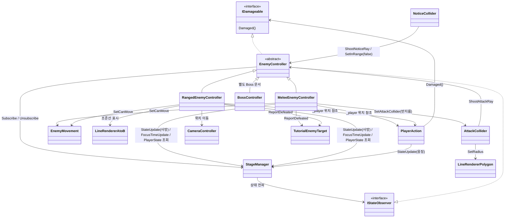

# Enemy

## 기능 개요

### 기능 정의

- 스테이지에 배치되는 일반 적(검병, 궁병)의 순찰, 플레이어 감지, 공격 판정, 피격 처리를 담당하는 시스템
- `StageManager`가 전달하는 게임 상태(`GameState`)에 따라 적의 행동을 전환
- 적 공통 구조(`EnemyController`)와 피해 수신 인터페이스(`IDamageable`)를 정의
- 게임 상태 관리와 상태 전파는 `StageManager`([GameState](./GameState.md)), 플레이어의 공격 경로 실행과 피해 전달은 `PlayerAction`([PlayerAttack](./PlayerAttack.md))에서 담당
- 보스(`BossController`)는 `EnemyController`를 상속하지만 [Boss](./Boss.md) 문서에서 다룸

### 주요 동작

- 적은 `StageManager`에 `IStateObserver`로 구독하고, 상태 변경 시 `IdleState()`, `FocusState()`, `PunishState()` 등으로 행동을 전환
- 플레이어 감지는 Trigger Collider(`NoticeCollider`, `AttackCollider`)로 범위 진입을 확인한 뒤, Raycast로 적과 플레이어 사이의 장애물 여부를 판정하는 2단계 구조
- 순찰 적은 `EnemyMovement`가 웨이포인트를 순환 이동하며, 집중 상태로 전환되거나 플레이어를 감지하면 이동·회전·대기 시간·애니메이션을 함께 일시정지하고, 기본 상태에서 감지 중이 아닐 때 재개 (호출 시점은 `순찰 및 일시정지` 6번 참고)
- 검병 : 플레이어 감지 시 순찰을 멈추고 공격 준비 자세로 전환, 기본 상태에서만 공격 범위가 시간에 따라 `_noticeRange`까지 확대되며, 공격 범위 안에서 Raycast가 플레이어에 닿으면 즉사 공격 실행
- 궁병 : 플레이어 감지 시 조준선(`LineRendererAtoB`)을 표시하고, 기본 상태에서만 준비 시간을 누적하며 조준선 두께를 키운 뒤, 준비 시간이 끝나면 즉사 공격 실행
- 응징 상태 전환 시 모든 적이 `ShootAttackRay()`로 공격 판정을 수행하며, 플레이어에 닿은 적이 즉사 공격 실행
- 즉사 공격 시 `GameState.사망`으로 상태 변경을 요청
- 피격 시 플레이어의 집중 시간을 `_returnTime`만큼 회복시키고 오브젝트 파괴

### 클래스 설명

- `EnemyController` (`Assets/Scripts/Enemy/EnemyController.cs`):
    - 적 공통 추상 클래스
    - `IDamageable`, `IStateObserver` 구현, `StageManager` 구독·해제 담당
- `MeleeEnemyController` (`Assets/Scripts/Enemy/MeleeEnemyController.cs`):
    - 검병의 감지, 공격 범위 확대, 공격 판정, 상태별 행동 처리
- `RangedEnemyController` (`Assets/Scripts/Enemy/RangedEnemyController.cs`):
    - 궁병의 감지, 조준 준비 시간, 공격 판정, 상태별 행동 처리
- `EnemyMovement` (`Assets/Scripts/Enemy/EnemyMovement.cs`):
    - 웨이포인트 순찰 이동·회전·대기 및 이동 가능 여부 제어
- `IDamageable` (`Assets/Scripts/Enemy/IDamageable.cs`):
    - 플레이어 공격으로 피해를 받는 대상의 인터페이스 (`Damaged()`)
- `NoticeCollider` (`Assets/Scripts/Enemy/NoticeCollider.cs`):
    - 감지 범위 Trigger, 플레이어 진입·이탈을 `EnemyController`에 전달
- `AttackCollider` (`Assets/Scripts/Enemy/AttackCollider.cs`):
    - 검병의 공격 범위 Trigger, 플레이어 진입을 `EnemyController`에 전달하고 범위 표시 원 크기 동기화

- 다른 시스템 소속 클래스 (Enemy 시스템에서 사용)
    - `StageManager` (`Assets/Scripts/StageManager.cs`, [GameState](./GameState.md)) : 게임 상태 보관 및 구독자에게 상태 전파, `FocusTimeUpdate()`로 플레이어 집중 시간 변경 중계
    - `IStateObserver` (`Assets/Scripts/IStateObserver.cs`), `GameState` (`Assets/Scripts/Core/GameState.cs`) : 상태 관찰 인터페이스와 상태 열거형 (`기본`, `집중`, `공격`, `응징`, `사망`, `클리어`)
    - `PlayerAction` (`Assets/Scripts/Player/PlayerAction.cs`, [PlayerAttack](./PlayerAttack.md)) : 적의 Raycast 대상, 공격 시 `IDamageable.Damaged()` 호출 및 공격 실패 시 `GameState.응징` 요청
    - `LineRendererAtoB` (`Assets/Scripts/UI/LineRendererAtoB.cs`) : 궁병 조준선 표시
    - `LineRendererPolygon` (`Assets/Scripts/UI/LineRendererPolygon.cs`) : 검병 공격 범위 원 표시
    - `CameraController` (`Assets/Scripts/Camera/CameraController.cs`) : 궁병 즉사 공격 시 위치 이동 대상
    - `TutorialEnemyTarget` (`Assets/Scripts/Tutorial/TutorialEnemyTarget.cs`, [Tutorial](./Tutorial.md)) : 튜토리얼 적 처치 보고 (부착된 경우만)
## 클래스 설계 및 구조

#### `EnemyController`

- 형태 : `MonoBehaviour` 추상 클래스, `IDamageable`, `IStateObserver` 구현
- 프로퍼티
    - `_noticeRange` : 감지 범위. `NoticeCollider`의 반지름, 감지 Raycast 길이, 검병 공격 범위의 상한, 궁병 공격 Raycast 길이로 사용
- 추상 메서드
    - `Damaged()`, `PunishAttack()`, `ShootNoticeRay()`, `ShootAttackRay()`, `SetInRange(bool inR)` : 파생 클래스가 개별 구현
- 메서드
    - `IdleState()` ~ `ClearState()` : 기본 구현은 비어 있으며, 파생 클래스가 필요한 상태만 재정의
    - `CacheComponents()` (protected virtual) : `Start()`에서 호출되어 `StageManager.Instance.Subscribe(this)` 수행
    - `OnDestroy()` (protected virtual) : `StageManager.Instance.Unsubscribe(this)` 수행

#### `MeleeEnemyController`

- 필드·프로퍼티
    - `_isInRange` : 감지 Ray가 플레이어에 닿아 공격 대기 중인지 여부
    - `_setAttackRange` : 공격 범위 초기값, 감지 해제 시 복귀값
    - `_addAttackRange` : 초당 공격 범위 증가량
    - `_attackRange` : 현재 공격 범위. `ShootAttackRay()`의 Ray 길이와 `AttackCollider` 반지름으로 사용
    - `_idle`, `_attackReady`, `_attack` : 대기·공격 준비·공격 모습 오브젝트, 상태에 따라 하나만 활성화
    - `_prevRotation` : 감지 직전의 회전값, 감지 해제 시 복구
    - `_player` (`PlayerAction`) : Ray 목표점, `LookPlayer()` 회전, `PunishAttack()` 이동 좌표 계산에 사용하는 직렬화 참조. 프리팹 값은 비어 있어 씬에서 지정 필요
    - `_layerMask` : Notice·Attack Ray의 충돌 대상 레이어. 이 마스크에 포함된 레이어 중 첫 충돌만 판정
- 메서드
    - `SetInRange(bool inR)` : 값이 같으면 무시. `true`이면 회전값 저장 후, 현재 상태가 `공격`이 아닐 때만 플레이어를 바라보고 공격 준비 모습으로 전환. `false`이면 회전값 복구 후 대기 모습으로 전환. 마지막에 `기본 상태 && !_isInRange`일 때만 이동 허용
    - `SetAttackRange()` (private, Coroutine) : `_isInRange` 동안 상태가 `기본`일 때만 `_attackRange`를 증가시키고 `AttackCollider`에 반영. 루프 종료 시 `_setAttackRange`로 복귀
    - `ShootNoticeRay()` : 높이 1에서 플레이어(+1) 방향으로 `_noticeRange + 0.05` 길이의 Ray 발사. 첫 충돌이 Player 레이어면 `SetInRange(true)` 후 `SetAttackRange()` 시작, 다른 오브젝트면 `SetInRange(false)`. 아무것도 닿지 않으면 처리 없음
    - `ShootAttackRay()` : 상태가 `공격`이면 즉시 반환. 그 외에는 `_attackRange + 0.05` 길이의 Ray를 발사해 첫 충돌이 Player 레이어면 `PunishAttack()` 실행
    - `PunishAttack()` (protected) : 공격 모습으로 전환, `GameState.사망` 요청 후 플레이어 위치 기준 공격 방향으로 1.2 더 나아간 지점으로 적을 이동
    - `OnEnable()` : `StageManager.Instance`가 있으면 현재 상태 기준으로 `EnemyMovement.SetCanMove()` 호출

#### `RangedEnemyController`

- 필드·프로퍼티
    - `_isInRange` : 감지 Ray가 플레이어에 닿아 조준 중인지 여부
    - `_attackCoolTime` : 감지 후 공격까지의 준비 시간
    - `_attackRange` : `Awake()`에서 `_noticeRange`로 설정되며 이후 변경되지 않음
    - `_attackCoroutine` : 진행 중인 조준 Coroutine 참조. 재감지 시 중단 후 재시작에 사용
    - `_punishMark` : 즉사 공격 시 표시되는 이미지
    - `_player`, `_layerMask` : 검병과 같은 용도. 궁병의 `_player`는 Ray 목표점과 `LookPlayer()`에만 사용하며, 프리팹 값이 비어 있어 씬에서 지정 필요
- 메서드
    - `ShootNoticeRay()` : 첫 충돌이 Player 레이어면 `SetInRange(true)`, 진행 중인 조준 Coroutine을 중단하고 조준선을 `Play(origin, target)`으로 다시 그린 뒤 `StartAttackCoolTime()` 재시작. 다른 오브젝트면 `SetInRange(false)`
    - `StartAttackCoolTime()` (private, Coroutine) : `_isInRange` 동안 상태가 `기본`일 때만 시간을 누적하고 조준선 두께를 `0 → 0.2`로 보간. `_attackCoolTime`을 넘으면 `PunishAttack()` 실행. 종료 시 조준선 숨김
    - `ShootAttackRay()` : 상태 조건 없이 `_attackRange + 0.05` 길이의 Ray를 발사해 플레이어에 닿으면 조준 Coroutine을 정리하고 `PunishAttack()` 실행
    - `PunishAttack()` (protected) : 플레이어를 바라본 뒤 `GameState.사망` 요청, `_punishMark` 활성화, 메인 카메라의 부모 `CameraController` 위치를 궁병 위치로 이동
    - `LookPlayer()` (private) : 회전뿐 아니라 `_idle` 비활성화, `_attack` 활성화도 함께 수행

#### `EnemyMovement`

- 필드
    - `_pathHolder` : 자식 Transform들을 순찰 웨이포인트로 사용 (순서 = 자식 순서, 마지막 지점 다음은 첫 지점)
    - `_startNum` : 시작 웨이포인트 인덱스
    - `_canMove` : 이동·회전·대기 시간 진행 허용 여부
    - `_remainingWaitTime` : 웨이포인트 도착 후 남은 대기 시간. `_canMove`가 `false`인 동안 감소하지 않음
- 메서드
    - `OnEnable()` : `_canMove = true`로 초기화하고, 웨이포인트 좌표의 y값을 자신의 높이로 맞춘 배열을 만들어 `FollowPath()` 시작
    - `SetCanMove(bool can)` : `_canMove` 설정과 함께 `Animator.speed`를 `1` 또는 `0`으로 변경해 애니메이션도 정지
    - `FollowPath()` (private, Coroutine) : 시작 지점으로 순간 이동 후 다음 지점을 바라보고 순환 이동. 도착 시 다음 지점 결정 → 대기 → `TurnToFace()` 완료 후 이동 재개. 매 단계 `_canMove`가 `false`면 해당 프레임을 건너뜀. Animator 파라미터 `IsWalking`을 `true`로만 설정하며 `false`로 바꾸는 코드는 없음
    - `TurnToFace()` (private, Coroutine) : 목표 각도와의 차이가 0.05도 이하가 될 때까지 `turnSpeed`로 회전
    - `Init()` : `GetComponentInChildren<Animator>(true)`로 `_animator`를 다시 할당하므로, Inspector에 지정한 값은 덮어써짐

#### `NoticeCollider`

- `Start()`에서 같은 오브젝트의 `SphereCollider.radius`를 `_enemyController._noticeRange`로 설정 (Inspector의 반지름 값은 사용되지 않음)
- `OnTriggerEnter` : Player 레이어 진입 시 `ShootNoticeRay()` 호출
- `OnTriggerExit` : Player 레이어 이탈 시 `SetInRange(false)` 호출

#### `AttackCollider`

- `Start()`에서 범위 표시 원(`LineRendererPolygon`) 반지름을 `SphereCollider`의 현재 반지름으로 설정
- `SetAttackCollider(float radius)` : `SphereCollider` 반지름과 범위 표시 원을 함께 변경
- `OnTriggerEnter` : Player 레이어 진입 시 `ShootAttackRay()` 호출
- `OnTriggerExit` : 로그 출력만 수행
- 프리팹 기준으로 `MeleeEnemy`, `MeleeEnemyWalking`에만 부착되어 있으며 `RangedEnemy`에는 없음

### 클래스 간 관계도

- `BossController`는 [Boss](./Boss.md), `StageManager`는 [GameState](./GameState.md), `PlayerAction`은 [PlayerAttack](./PlayerAttack.md), `TutorialEnemyTarget`은 [Tutorial](./Tutorial.md) 문서 참고

### 실행 절차 흐름

#### 초기화

1. `Awake()` : 각 컨트롤러의 `Init()`에서 `_isInRange = false`, 공격 범위 초기화(검병 `_setAttackRange`, 궁병 `_noticeRange`), 표시 오브젝트 초기화. `EnemyMovement.Init()`에서 `_animator` 할당
2. `OnEnable()` : `EnemyMovement`가 웨이포인트 배열을 만들고 `FollowPath()` 시작. 검병은 `StageManager.Instance`가 있으면 현재 상태 기준으로 이동 가능 여부 설정
3. `Start()` : `EnemyController.CacheComponents()`에서 `StageManager`에 구독. `NoticeCollider`는 반지름을 `_noticeRange`로 설정, `AttackCollider`는 범위 표시 원 반지름 설정
4. `StageManager.Start()`에서 `StateUpdate(GameState.기본)`이 호출되면 그 시점까지 구독된 적의 `IdleState()` 실행
    - 적의 구독(`Start()`)과 `StageManager.Start()`의 실행 순서는 Script Execution Order가 설정되어 있지 않아(`Assets/Scripts` 하위 `.meta`의 `executionOrder` 모두 0) 보장되지 않음. 적이 나중에 구독하면 최초 `IdleState()`를 받지 못할 수 있음 (코드 분석 기준, 미검증)
    - `PlayerAction.OnEnable()`의 `StateUpdate(GameState.기본)`은 모든 `Start()`보다 먼저 실행되므로 적의 구독 전에 호출됨

#### 순찰 및 일시정지 (`EnemyMovement`)

1. `FollowPath()`가 `_canMove`가 `true`일 때만 `Vector3.MoveTowards()`로 목표 웨이포인트까지 이동하고 `IsWalking` 애니메이션 파라미터를 `true`로 설정 (이후 `false`로 바뀌지 않으며 웨이포인트 대기 중에도 `true` 유지)
2. 도착 시 다음 웨이포인트 인덱스를 순환 계산하고 `waitTime`만큼 대기 (`_canMove`가 `false`인 동안 대기 시간 정지)
3. `TurnToFace()`로 다음 웨이포인트 방향까지 회전 (`_canMove`가 `false`인 동안 회전 정지)
4. 컨트롤러가 `SetCanMove(false)`를 호출하면 위 과정이 현재 위치·남은 대기 시간·목표 지점을 유지한 채 멈추고 `Animator.speed = 0`이 됨
5. `SetCanMove(true)` 호출 시 멈춘 지점부터 이어서 진행
6. `SetCanMove()` 호출 시점
    - 검병 `OnEnable()` : `기본 상태 && !_isInRange` (`StageManager.Instance`가 있을 때만)
    - `FocusState()` : `false`
    - `IdleState()` : `!_isInRange`
    - `SetInRange()` : `기본 상태 && !_isInRange`

#### 검병 감지 및 공격

1. 플레이어가 `NoticeCollider`에 진입 → `ShootNoticeRay()`
2. Ray가 플레이어에 닿으면 `SetInRange(true)` : 이동 정지, 플레이어를 바라보고 공격 준비 모습으로 전환
3. `SetAttackRange()` 시작 : 기본 상태에서만 `_attackRange`가 초당 `_addAttackRange`씩 증가 (최대 `_noticeRange`), `AttackCollider` 반지름과 범위 표시 원이 함께 커짐
4. 플레이어가 `AttackCollider`에 진입 → `ShootAttackRay()` : 상태가 `공격`이 아니고 Ray가 플레이어에 닿으면 `PunishAttack()` → `GameState.사망` 요청
5. 플레이어가 `NoticeCollider`에서 이탈 → `SetInRange(false)` : 회전 복구, 대기 모습. 이동은 현재 상태가 `기본`일 때만 재개되며, 그 외 상태(예 : 플레이어가 이동하는 `공격` 상태)에서는 정지를 유지하다가 이후 `IdleState()`에서 재개. `SetAttackRange()` 루프가 끝나며 공격 범위가 `_setAttackRange`로 복귀
6. 상태가 `기본`으로 돌아올 때마다 `IdleState()`에서 `ShootAttackRay()`를 다시 수행

#### 궁병 감지 및 공격

1. 플레이어가 `NoticeCollider`에 진입하거나, 상태가 `기본`으로 전환되어 `IdleState()`가 호출되면 `ShootNoticeRay()` 실행
2. Ray가 플레이어에 닿으면 `SetInRange(true)` : 이동 정지, 공격 모습으로 전환
3. 기존 조준 Coroutine을 중단하고 조준선을 궁병 → 플레이어 위치로 표시한 뒤 `StartAttackCoolTime()`을 처음부터 시작
4. 기본 상태에서만 준비 시간이 누적되며 조준선 두께 증가
5. 준비 시간이 `_attackCoolTime`을 넘으면 `PunishAttack()` → `GameState.사망` 요청, `_punishMark` 표시, 카메라를 궁병 위치로 이동
6. 준비 도중 Ray가 장애물에 막히거나 `NoticeCollider`에서 이탈하면 `SetInRange(false)` → Coroutine 루프 종료, 조준선 숨김. 이동은 현재 상태가 `기본`일 때만 재개 (`IdleState()` → `ShootNoticeRay()`에서 막힌 경우는 `기본` 상태이므로 즉시 재개, 그 외 상태에서는 이후 `IdleState()`에서 재개)

#### 응징 상태

1. `PlayerAction.Attack()`에서 경로상 적을 맞히지 못하면 `StageManager.StateUpdate(GameState.응징)` 요청
2. `StageManager`가 구독자 목록 순서대로 `PunishState()` 호출
3. 검병·궁병 모두 `ShootAttackRay()` 실행 (검병은 현재 `_attackRange`, 궁병은 `_noticeRange` 길이)
4. Ray가 플레이어에 닿은 적은 `PunishAttack()` 실행 → `GameState.사망` 요청

#### 피격

1. `PlayerAction.Attack()`이 `SphereCastAll`로 찾은 대상에 `GetComponentInParent<IDamageable>().Damaged()` 호출
2. `Damaged()` : `TutorialEnemyTarget`이 있으면 처치 보고 → `StageManager.FocusTimeUpdate(_returnTime)`으로 플레이어 집중 시간 증가 → `Destroy(gameObject)`
3. `OnDestroy()`에서 `StageManager` 구독 해제

### 설계 결정 및 주의사항

#### 설계 결정

- `범위 감지(Trigger)와 공격 판정(Raycast) 분리` : Trigger Collider로 플레이어의 범위 진입을 감지해도 적과 플레이어 사이에 장애물이 있을 수 있으므로, Raycast로 실제 공격 대상을 확인해 공격 여부를 결정한다.
- `EnemyController 추상 클래스로 공통 구조 분리` : 피해 처리, 공격 판정, 상태별 행동 메서드를 추상 클래스에 정의하고, 검병·궁병·보스가 상속해 서로 다른 공격 방식을 구현한다. `NoticeCollider`, `AttackCollider`는 `EnemyController` 타입만 참조한다.
- `Time.timeScale 대신 _canMove 조건으로 적 행동 정지` : 집중·공격 상태에서 플레이어의 경로 예약과 UI 연출은 계속 동작해야 하므로, 시간 전체를 멈추지 않고 Coroutine 내부에서 `_canMove`를 확인해 이동·회전·대기를 개별 정지하고 `Animator.speed`로 애니메이션을 함께 정지한다.
- `Coroutine을 재시작하지 않고 일시정지` : 목표 웨이포인트와 남은 대기 시간을 유지해, 집중 해제 후 중단된 지점부터 순찰을 이어가기 위함이다.

#### 주의사항

- `Notice Ray 재판정 시점의 차이` : 검병의 `ShootNoticeRay()`는 `NoticeCollider.OnTriggerEnter`에서만 호출된다. 진입 시점에 Ray가 장애물에 막혔다면, 플레이어가 Trigger 안에 머무는 동안에는 다시 판정하지 않는다. 궁병은 `IdleState()`에서도 `ShootNoticeRay()`를 호출하므로 기본 상태 전환마다 재판정된다.
- `궁병 조준 준비 시간 초기화` : 궁병은 `IdleState()`에서 플레이어가 감지되면 조준 Coroutine을 중단 후 재시작하므로, 집중·공격 상태를 거쳐 기본 상태로 돌아올 때마다 누적된 준비 시간이 0으로 초기화된다. 준비 시간 유지 방식으로 바꾸려면 `ShootNoticeRay()`의 Coroutine 재시작 조건을 함께 수정해야 한다.
- `궁병 준비 완료 시 Raycast 재판정 없음` : `StartAttackCoolTime()`은 준비 시간이 끝나면 Raycast 없이 `PunishAttack()`을 호출한다. 시야 확인은 감지 시점(`ShootNoticeRay()`)에만 수행되며, 조준선 끝점도 감지 시점의 플레이어 위치로 고정된다.
- `검병 공격 범위 Coroutine 중복 가능성` : `ShootNoticeRay()`는 `SetInRange(true)`가 중복 호출로 무시된 경우에도 `StartCoroutine(SetAttackRange())`를 조건 없이 호출한다. 이미 감지 중인 상태에서 `OnTriggerEnter`가 다시 발생하면 Coroutine이 여러 개 실행되어 공격 범위 증가 속도가 배가될 수 있다. (코드 분석 기준, 실행 검증 기록 없음)
- `검병 ShootAttackRay의 상태 조건` : 상태가 `공격`일 때만 공격 판정을 건너뛴다. 궁병의 `ShootAttackRay()`에는 상태 조건이 없으며, 현재 호출 경로가 `PunishState()`뿐이라 문제가 드러나지 않는다. 궁병에 `AttackCollider`를 추가하면 상태 조건을 함께 검토해야 한다.
- `응징 상태에서 다중 즉사 공격` : `StageManager`는 `PunishState()`를 모든 구독자에게 순서대로 호출하며, `GameState.사망` 요청에는 중복 방지 조건이 없다. 여러 적의 Ray가 동시에 플레이어에 닿으면 각 적이 `PunishAttack()`을 실행하고 `DeadState()` 전파가 반복된다.
- `검병 PunishAttack 이동 좌표` : 이동 좌표가 `플레이어 위치 + (0, 1, 0)`을 기준으로 계산되므로, 적의 y좌표가 원래 높이와 달라질 수 있다.
- `AttackCollider 초기 반지름` : 시작 시 `AttackCollider`의 반지름은 Inspector의 `SphereCollider` 값이며, `_setAttackRange`와 자동으로 맞춰지지 않는다. 첫 `SetAttackRange()` 실행 전까지 두 값이 다르면 공격 범위 판정(Collider)과 Ray 길이(`_attackRange`)가 어긋난다. 현재 프리팹은 두 값 모두 2로 동일하다.
- `NoticeCollider 반지름은 코드가 덮어씀` : `Start()`에서 `_noticeRange`로 설정되므로 Inspector의 `SphereCollider` 반지름을 바꿔도 반영되지 않는다. 감지 범위는 컨트롤러의 `_noticeRange`로 조정해야 한다.
- `OnEnable 실행 순서` : 검병의 `OnEnable()`은 `EnemyMovement.SetCanMove()`를 호출하고, `EnemyMovement.OnEnable()`은 `_canMove = true`로 초기화한다. 같은 오브젝트의 두 컴포넌트 간 `OnEnable` 실행 순서는 보장되지 않으므로, 검병의 설정이 덮어써질 수 있다.
- `EnemyMovement의 null 처리 불일치` : `SetCanMove()`는 `_animator` null을 확인하지만 `FollowPath()`의 `_animator.SetBool("IsWalking", true)`는 확인하지 않는다. 자식에 Animator가 없는 오브젝트에 부착하면 예외가 발생한다. `_pathHolder`가 비어 있으면 `OnEnable()`과 `OnDrawGizmos()`에서도 예외가 발생한다.
- `중복 로직` : `MeleeEnemyController`와 `RangedEnemyController`의 `Damaged()`, `FocusState()`, Ray 원점·방향 계산, `LookPlayer()`의 회전 처리가 각 파생 클래스에 동일하게 작성되어 있다. 공통 동작을 수정할 때 양쪽을 함께 수정해야 한다.
- `하드코딩된 값` : Ray 원점 높이 `1f`, 목표점 보정 `Vector3.up`, Ray 길이 여유 `0.05f`, 검병 공격 후 이동 거리 `1.2f`, 궁병 조준선 최대 두께 `0.2f`, 회전 완료 허용 오차 `0.05f`, 집중 표시 페이드 시간(`0.01f`, `1f`)이 코드에 고정되어 있다. 레이어 이름 `"Player"`와 Animator 파라미터 `"IsWalking"`도 문자열로 참조하므로 이름 변경 시 함께 수정해야 한다.
- `디버그 출력 잔존` : `EnemyMovement.FollowPath()`는 이동 중 매 프레임 `Debug.Log`를 출력하고, `MeleeEnemyController.SetInRange()`, `RangedEnemyController.ShootNoticeRay()`, `AttackCollider`에도 로그가 남아 있다. `Debug.Log`는 에디터 전용 코드가 아니므로 빌드에서도 호출된다. 순찰 적 수에 비례해 로그가 늘어나며, 실행 성능에 주는 영향은 측정 기록이 없다. (코드 분석 기준, 미검증)
- `MeleeEnemyController.cs 파일 인코딩` : 이 파일만 UTF-8이 아닌 한국어 레거시 인코딩(CP949)으로 저장되어 있으며, `GameState.기본`, `GameState.공격`, `GameState.사망` 등 한글 식별자를 포함한다. UTF-8로 읽는 도구에서는 식별자가 깨져 보이므로, 인코딩을 변환하지 않은 채 다른 인코딩으로 저장하면 식별자가 손상될 수 있다.
- `EnemyMovement는 씬에서 부착` : 적 프리팹(`MeleeEnemy`, `MeleeEnemyWalking`, `RangedEnemy`)에는 `EnemyMovement`가 없고 씬 인스턴스에 추가되어 있다. 컨트롤러는 `_enemyMovement?.SetCanMove()`처럼 null 조건 연산자로 호출한다. 프리팹을 새로 배치할 때 순찰이 필요하면 `EnemyMovement`와 `_pathHolder`를 씬에서 직접 설정해야 한다.
- `GetComponent 결과에 대한 ?. 사용` : `_enemyMovement?.SetCanMove()`, `GetComponent<EnemyMovement>()?.SetCanMove()`, `GetComponent<TutorialEnemyTarget>()?.ReportDefeated()`는 C#의 null 조건 연산자를 사용하며, 이 연산자는 `UnityEngine.Object`의 `==` 재정의를 거치지 않는다. Unity 에디터에서는 `GetComponent`가 컴포넌트를 찾지 못했을 때 실제 null 대신 fake null 객체를 반환할 수 있어, `?.`가 이를 걸러내지 못하고 메서드를 호출할 수 있다. 이때 메서드 내부에서 엔진 API에 접근하면 예외가 발생할 수 있으며, 빌드에서는 실제 null이 반환되어 에디터와 동작이 다를 수 있다. null 확인이 필요하면 `TryGetComponent()` 또는 `!= null` 비교를 검토한다. (Unity 엔진 동작 기반 분석, 미검증)
- `_player 씬 연결 필요` : 검병·궁병 프리팹(`MeleeEnemy`, `MeleeEnemyWalking`, `RangedEnemy`)의 `_player`는 비어 있으므로 씬에서 `PlayerAction`을 지정해야 한다. Ray 목표점, `LookPlayer()`, 검병 `PunishAttack()`이 모두 `_player.transform`을 사용하며, `LookPlayer()`의 `_player.transform != null` 검사는 `_player` 자체가 비어 있는 경우를 막지 못한다. 지정하지 않으면 감지·공격 판정 시 예외가 발생할 수 있다. (코드 분석 기준, 미검증)
- `_layerMask 설정 의존` : Notice·Attack Ray는 `_layerMask`에 포함된 레이어만 충돌 대상으로 하므로, 장애물로 판정하려는 레이어가 마스크에 포함되어야 설계 결정의 장애물 판정이 성립한다. 프리팹 기본값은 검병 `2368`(Player, Wall, DestroyObj), 궁병 `2880`(Player, Wall, Enemy, DestroyObj)으로 서로 다르다(레이어 이름은 `ProjectSettings/TagManager.asset` 기준). 씬 인스턴스에서 `832`(Player, Wall, Enemy)로 덮어쓴 경우가 있고, `StageScene`에는 `1088`(Player, OverUI) 오버라이드도 1건 있다. 각 오버라이드가 어느 인스턴스의 어느 컴포넌트에 적용되는지는 확인하지 않았다. 레이어를 추가·변경하면 프리팹과 씬 인스턴스의 마스크를 함께 확인해야 한다.
- `IsWalking이 false로 바뀌지 않음` : `EnemyMovement.FollowPath()`는 `IsWalking`을 `true`로만 설정하며, 프로젝트 내 `Assets/Scripts`에 `false`로 바꾸는 코드가 없다. 웨이포인트 대기 중에도 `true`가 유지되며, 일시정지는 `Animator.speed = 0`으로만 처리된다. 대기 중 애니메이션 표시에 주는 영향은 Animator Controller 설정에 따라 다르다. (코드 분석 기준, 미검증)
- `최초 IdleState() 수신의 실행 순서 의존` : 적은 `Start()`에서 구독하고 `StageManager`도 `Start()`에서 `StateUpdate(GameState.기본)`을 호출하며, Script Execution Order가 설정되어 있지 않다. 적이 `StageManager`보다 늦게 구독하면 최초 `IdleState()`를 받지 못해, 궁병의 시작 시 `ShootNoticeRay()`, 검병의 `ShootAttackRay()` 등 `IdleState()`의 처리가 다음 `기본` 상태 전환까지 실행되지 않을 수 있다. 초기화 순서를 바꿀 때 함께 확인해야 한다. (코드 분석 기준, 미검증)
