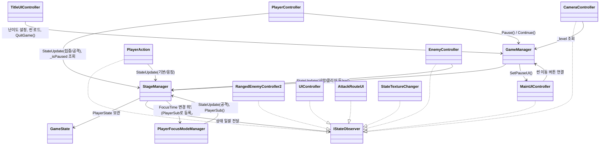

# GameState

## 기능 개요

### 기능 정의

- 스테이지 씬의 전역 게임 상태(기본, 집중, 공격, 응징, 사망, 클리어)를 하나로 관리하는 시스템
- 상태 변경 요청을 받아 전이 가능 여부를 판정하고, 확정된 상태를 구독자(`IStateObserver` 구현체)에 일괄 전달
- 일시정지 여부, 집중 게이지(FocusTime) 변경 요청의 중계를 함께 담당
- 씬 전환, 난이도 값 보관, 일시정지 시 `Time.timeScale` 제어는 `GameManager`가 담당
- 상태별 실제 행동(플레이어 공격, 적 응징, UI 표시 등)은 각 구독자가 담당하며 이 시스템의 범위가 아님
    - 플레이어 공격·집중 게이지 : [PlayerAttack](./PlayerAttack.md)
    - 일반 적 : [Enemy](./Enemy.md), 보스 : [Boss](./Boss.md)
    - 튜토리얼 진행 : [Tutorial](./Tutorial.md)

### 주요 동작

- 상태 변경은 모두 `StageManager.Instance.StateUpdate(GameState)` 호출로 요청
- `StateUpdate()`는 요청 상태에 따라 `PlayerState`를 갱신하고, `switch`문으로 구독자의 대응 메서드(`IdleState()` 등)를 순서대로 호출
- 선행 상태 조건은 `집중`(현재 `기본`일 때만), `공격`(현재 `집중`일 때만) 두 가지만 `StateUpdate()` 내부에서 검사
- 현재 상태가 `클리어`이면 `클리어` 이외의 요청을 모두 무시
- 일시정지 중(`_isPaused == true`)에는 모든 상태 변경 요청을 무시 (보류하지 않고 폐기)
- `사망` 상태는 지연 없이 즉시 구독자에 전달하며, 게임오버 연출 지연은 구독자 측 코루틴이 처리
- 집중 게이지 변경 요청(`FocusTimeUpdate()`)은 등록된 `PlayerFocusModeManager`에 그대로 위임
- `GameManager`는 씬을 넘어 유지되며, 씬 로드·재시작·다음 씬 이동과 일시정지/재개를 처리

### 클래스 설명

- `StageManager` (`Assets/Scripts/StageManager.cs`):
    - 씬 단위 싱글톤
    - 전역 게임 상태 보관, 상태 전이 판정, 구독자 등록·해제 및 상태 전달
    - 일시정지 플래그 보관, 집중 게이지 변경 요청 중계
- `GameState` (`Assets/Scripts/Core/GameState.cs`):
    - 전역 게임 상태 6종을 정의하는 enum
- `IStateObserver` (`Assets/Scripts/IStateObserver.cs`):
    - 상태별 대응 메서드 6개를 선언한 구독자 인터페이스
- `GameManager` (`Assets/Scripts/GameManager.cs`):
    - `DontDestroyOnLoad` 싱글톤
    - 씬 전환, 난이도(`Level`) 설정·보관, 일시정지/재개 처리
    - 난이도 enum `Level`도 같은 파일에 선언
    - 일시정지 시 `StageManager`의 일시정지 플래그와 `MainUIController`의 일시정지 UI를 함께 갱신

- 다른 시스템 소속 클래스 (관계 설명용, 이 문서의 대상 아님)
    - 구독자(`IStateObserver` 구현) : `PlayerAction`, `EnemyController`(파생 `MeleeEnemyController`, `RangedEnemyController`, `BossController`), `RangedEnemyController2`, `UIController`, `MainUIController`, `CameraController`, `AttackRouteUI`, `StateTextureChanger`
    - 상태 변경 요청자 : `PlayerController`, `PlayerAction`, `PlayerFocusModeManager`, `MeleeEnemyController`, `RangedEnemyController`, `RangedEnemyController2`, `BossController`, `SwordAttackCollider`, `DestoryObj`, `TutorialManager`
    - 집중 게이지 소유 : `PlayerFocusModeManager`
    - 난이도 설정·씬 이동 요청 : `TitleUIController`
    - 소속 문서 : `PlayerController`·`PlayerAction`·`PlayerFocusModeManager`·`AttackRouteUI`는 [PlayerAttack](./PlayerAttack.md), `EnemyController`·`MeleeEnemyController`·`RangedEnemyController`는 [Enemy](./Enemy.md), `BossController`·`SwordAttackCollider`·`SwordObj`는 [Boss](./Boss.md), `TutorialManager`는 [Tutorial](./Tutorial.md)

## 클래스 설계 및 구조

#### `StageManager`

- 형태 : `MonoBehaviour`, 씬 싱글톤 (`DontDestroyOnLoad` 미사용)
- 필드·프로퍼티
    - `PlayerState` (`GameState`, public get / private set, `[field: SerializeField]`) : 현재 전역 게임 상태. 이름은 `PlayerState`이지만 플레이어 개인 상태가 아니라 씬 전체의 게임 상태를 의미
    - `_subscriber` (`List<IStateObserver>`) : 구독자 목록. 등록 순서가 곧 상태 전달 순서
    - `_player` (`PlayerFocusModeManager`) : 집중 게이지 변경을 위임할 대상. `PlayerSub()`로만 설정됨
    - `_isPaused` (`bool`, public get / private set) : 일시정지 여부. `SetPause()`로만 변경
- 메서드
    - `Awake()` : `SetSingleton()`으로 `Instance` 설정 후 `Init()` 호출 (`Init()`은 현재 빈 메서드)
    - `Start()` → `CasheComponent()` : `StateUpdate(GameState.기본)`을 호출해 씬 시작 시 기본 상태를 전달
    - `StateUpdate(GameState state)` : 아래 순서로 처리
        1. 현재 상태가 `클리어`이고 요청이 `클리어`가 아니면 즉시 반환
        2. `_isPaused`가 `true`이면 아무것도 하지 않음
        3. 요청 상태별 처리
            - `기본` : 조건 없이 전이, 구독자 `IdleState()` 호출
            - `집중` : 현재 `기본`일 때만 전이, 구독자 `FocusState()` 호출
            - `공격` : 현재 `집중`일 때만 전이, 구독자 `AttackState()` 호출
            - `응징` : 조건 없이 전이, 구독자 `PunishState()` 호출
            - `사망` : 조건 없이 전이, `Die()`에서 구독자 `DeadState()` 호출
            - `클리어` : 조건 없이 전이, 구독자 `ClearState()` 호출
        - 조건 불충족 시 상태 변경과 전달 모두 일어나지 않으며, 호출자에게 결과를 반환하지 않음 (`void`)
    - `Die()` (private) : 구독자에게 `DeadState()`를 즉시 전달. 과거 코루틴 호출(`//StartCoroutine(Die());`)이 주석으로 남아 있음
    - `Subscribe(IStateObserver)` / `Unsubscribe(IStateObserver)` : `List.Add` / `List.Remove`. 중복 등록 검사 없음
    - `PlayerSub(PlayerFocusModeManager player)` : 집중 게이지 위임 대상 등록. `PlayerFocusModeManager.Start()`에서 호출
    - `FocusTimeUpdate(float value)` : `_player.ChangeFocusTime(value)`로 위임. 호출처는 `AttackRouteUI`(경로 확정), `PlayerAction.Undo()`(경로 취소), `MeleeEnemyController`·`RangedEnemyController`·`SwordObj`의 `Damaged()`(처치 보상)
    - `SetPause(bool value)` : `_isPaused` 설정. `GameManager.Pause()` / `Continue()`에서 호출
    - `SetSingleton()` (private) : `Instance`가 이미 있고 자신이 아니면 `Destroy(gameObject)`, 아니면 `Instance = this`

#### `GameState`

- 형태 : enum
- 값 : `기본`, `집중`, `공격`, `응징`, `사망`, `클리어` (선언 순서대로 0 ~ 5)
- 각 값의 의미 (코드상 사용처 기준)
    - `기본` : 일반 진행 상태. 적 이동·공격 준비 시간, 집중 게이지 충전이 진행됨
    - `집중` : 공격 경로를 예약하는 상태. 집중 게이지가 소모됨
    - `공격` : 예약된 경로로 플레이어가 공격을 실행하는 상태
    - `응징` : 공격 경로상 적을 처치하지 못했거나(`PlayerAction`), 보스 검진 파훼에 실패한(`BossController`) 경우 진입. 적의 반격 판정이 실행됨
    - `사망` : 플레이어 사망 상태
    - `클리어` : 스테이지 클리어 상태. 이후 다른 상태로 전이되지 않음

#### `IStateObserver`

- 형태 : interface
- 메서드 : `IdleState()`, `FocusState()`, `PunishState()`, `AttackState()`, `DeadState()`, `ClearState()`
    - `GameState` 값 하나당 메서드 하나가 대응하며, 구현체는 6개를 모두 구현해야 함. 대응이 필요 없는 상태는 빈 메서드로 둠
- 구독 등록·해제는 인터페이스가 강제하지 않으며, 구현체마다 방식이 다름
    - `PlayerAction`, `UIController`, `MainUIController`, `CameraController` : `Start()` 흐름에서 `Subscribe(this)`만 호출하고 `Unsubscribe()`는 호출하지 않음
    - `MeleeEnemyController`, `RangedEnemyController`, `BossController` : 직접 호출하지 않고, `base.Start()`로 기반 클래스 `EnemyController`의 `Start()` → `CacheComponents()`에서 구독, `EnemyController.OnDestroy()`에서 해제 (세 파생 클래스의 `OnDestroy()` 재정의는 주석 처리되어 있음)
    - `RangedEnemyController2`, `AttackRouteUI`, `StateTextureChanger` : 각자 `Start()` 흐름에서 `Subscribe(this)`, `OnDestroy()`에서 `Unsubscribe(this)` 호출

#### `GameManager`

- 형태 : `MonoBehaviour`, `DontDestroyOnLoad` 싱글톤
- 필드·프로퍼티
    - `_titleScene`, `_tutorialScene`, `_stageScene`, `_bossScene` (`SceneReference`) : 인스펙터에서 지정하는 씬 참조
    - `_level` (`Level`, public get / private set, `[field: SerializeField]`) : 난이도. `SetNormalLevel()`·`SetHardLevel()`로만 변경되며, `CameraController.SetLevel()`이 읽어 카메라 컬링 마스크를 결정
- 함께 선언된 타입
    - `Level` (enum, `GameManager.cs`) : `보통`, `어려움`
- 메서드
    - `SetNormalLevel()` / `SetHardLevel()` : `_level`을 `보통` / `어려움`으로 설정. 호출처는 타이틀 화면의 `TitleUIController.SetNormalLevel()` / `SetHardLevel()`
    - `TitleSceneSceneLoad()` / `TutorialSceneLoad()` / `StageSceneLoad()` / `BossSceneLoad()` : `Time.timeScale = 1f`로 복구한 뒤 해당 씬 로드
    - `NextSceneSceneLoad()` : 씬 판별 전에 항상 `Time.timeScale = 1f`로 복구한 뒤, 현재 씬이 튜토리얼이면 스테이지, 스테이지이면 보스 씬 로드. 그 외 씬에서는 `timeScale` 복구만 하고 씬을 로드하지 않음
    - `RetrySceneLoad()` : `Time.timeScale = 1f` 후 현재 활성 씬 재로드
    - `Pause()` : `Time.timeScale = 0f`, `StageManager.Instance.SetPause(true)`, `FindFirstObjectByType<MainUIController>()?.SetPauseUI(true)` 순서로 처리
    - `Continue()` : `Pause()`의 역순 값(`1f`, `false`)으로 동일하게 처리
    - `QuitGame()` : 에디터에서는 플레이 모드 종료, 빌드에서는 `Application.Quit()`
    - `SetSingletion()` (private) : 중복 인스턴스는 `Destroy(gameObject)` 후 `return`, 최초 인스턴스는 `DontDestroyOnLoad(gameObject)`

### 클래스 간 관계도

- `IStateObserver` 구현체와 상태 변경 요청자는 다른 시스템 소속이며, 이 시스템과의 연결 방식만 표시
- `EnemyController` 화살표는 파생 클래스(`MeleeEnemyController`, `RangedEnemyController`, `BossController`)의 호출을 묶어 표시
- 관계도에서 생략한 상태 변경 요청자 : `RangedEnemyController2`(`사망`), `SwordAttackCollider`(`사망`), `DestoryObj`(`클리어`), `TutorialManager`(`NextDialogue()`에서 현재 상태가 `기본`이 아니면 `기본`, `CheckCompletion()`에서 `클리어`)

### 실행 절차 흐름

#### 초기화

Unity 생명주기 단계 기준으로 나눈 것이며, 같은 단계 안의 항목 나열 순서는 실행 순서를 뜻하지 않는다.

1. Awake 단계 (모든 `Start()` 이전)
    - `StageManager.Awake()` : `Instance` 설정
    - `GameManager.Awake()` : 로드한 씬에 `GameManager`가 배치되어 있으면 씬 로드마다 실행. 최초 인스턴스만 `Instance` 설정 및 `DontDestroyOnLoad`, 이후 씬의 중복 인스턴스는 `Destroy(gameObject)`
    - `PlayerAction.OnEnable()` : `StateUpdate(GameState.기본)` 호출. 새 씬의 `StageManager.Instance`가 이미 설정된 경우, 이 시점에는 `Start()`에서 구독하는 구독자가 아직 등록되지 않았으므로 `PlayerState`만 `기본`으로 갱신되고 콜백은 전달되지 않음
2. Start 단계
    - 각 구독자 `Start()` : `StageManager.Instance.Subscribe(this)`
    - `PlayerFocusModeManager.Start()` : `StageManager.Instance.PlayerSub(this)`
    - `StageManager.Start()` : `StateUpdate(GameState.기본)` → 그 시점까지 등록된 구독자에게 `IdleState()` 전달
    - `BossController.Start()` : `StateUpdate(GameState.기본)` 호출 → 그 시점까지 등록된 구독자에게 `IdleState()` 전달

- 같은 단계 안의 상대 순서(`StageManager.Awake()`와 `GameManager.Awake()` 포함)는 Unity의 호출 순서에 따르며, 프로젝트에서 별도로 지정하지 않음 (`.meta`에 0 이외의 `executionOrder` 없음, `DefaultExecutionOrder` 미사용)
- Start 단계에서는 `StageManager.Start()`와 `BossController.Start()`가 각각 `기본`을 전달하므로, 보스 씬에서는 구독자가 `IdleState()`를 여러 번 받을 수 있음 (코드 분석 기준, 미검증)

#### 기본 → 집중 → 공격 → 기본 (정상 공격 흐름)

1. `PlayerController.FocusState()` (집중 입력) : 튜토리얼 대사 표시 중이거나 `_focusTime < 1f`이면 요청하지 않음
2. `StateUpdate(GameState.집중)` : 현재 `기본`이면 `집중`으로 전이, 구독자 `FocusState()` 호출
3. 집중 중 `PlayerFocusModeManager.Update()`가 게이지를 소모하고, 경로 확정·취소 시 `FocusTimeUpdate()`로 게이지 증감
4. 공격 진입 경로 (둘 중 하나)
    - `PlayerController.AttackState()` (공격 입력) → `StateUpdate(GameState.공격)`
    - `PlayerFocusModeManager.Update()`에서 `_focusTime <= 0` → `StateUpdate(GameState.공격)`
5. `StateUpdate(GameState.공격)` : 현재 `집중`이면 `공격`으로 전이, 구독자 `AttackState()` 호출
6. `PlayerAction.AttackState()`
    - `_pointList.Count <= 1`이면 `ResetAttack()` 후 `StateUpdate(GameState.기본)`을 즉시 호출하고 종료
        - `_pointList`의 0번 요소는 집중 진입 시 생성된 첫 `AttackRouteUI`가 등록한 시작 지점(플레이어 위치)이며, 경로를 확정할 때마다 1개씩 추가됨. 따라서 이 조건은 "확정한 경로가 0개"인 경우 (첫 `AttackRouteUI`가 `_attackRouteCanvas` 프리팹 루트에 있는지는 프리팹을 열어 확인하지 않음. `Attack()`의 `i = 1` 순회와 `Undo()`의 `Count <= 1` 검사가 이 구조를 뒷받침함)
    - 경로를 1개 이상 확정했으면(`Count >= 2`) `Attack()` 코루틴 실행. `Attack()`은 1번 요소부터 순회
7. `Attack()` 코루틴 종료 시 `StateUpdate(GameState.기본)` 호출 → 구독자 `IdleState()`

#### 응징 → 사망

1. `PlayerAction.Attack()`에서 경로상 적이 없으면 `StateUpdate(GameState.응징)` 호출 (보스 씬에서는 `BossController.CastingAttack()`의 검진 파훼 실패 시에도 호출)
2. 구독자 `PunishState()` 호출 → 적 구독자가 자신의 판정(Raycast 등)으로 반격 가능 여부 확인
3. 반격 가능 시 해당 적이 `StateUpdate(GameState.사망)` 호출 (이 호출은 2의 전달 루프 안에서 일어남)
4. `Die()` → 구독자 `DeadState()` 즉시 호출
    - `PlayerAction.DeadState()` : `StopAllCoroutines()`로 진행 중인 공격 중단, 1초 뒤 `Time.timeScale = 0f`
    - `MainUIController.DeadState()` : 1초 뒤 게임오버 UI 표시

- 사망은 응징 외에도 `SwordAttackCollider`(트리거 진입), `BossController`(대시·즉사 패턴) 등에서 직접 요청됨
- `RangedEnemyController`는 `기본` 상태에서만 누적되는 공격 준비 시간이 `_attackCoolTime`을 넘으면 `PunishAttack()`을 호출해, `응징`을 거치지 않고 `StateUpdate(GameState.사망)`을 직접 요청함

#### 클리어

1. `BossController.Damaged()`(생명 0), `DestoryObj.Damaged()`(`_isClearTarget`), `TutorialManager.CheckCompletion()`(마지막 파트 완료)에서 `StateUpdate(GameState.클리어)` 호출
2. `PlayerState = 클리어`, 구독자 `ClearState()` 호출 → `MainUIController`가 1초 뒤 클리어 UI 표시
3. 이후 들어오는 `클리어` 외 요청(예: `PlayerAction.Attack()` 종료 시 `기본` 요청)은 `StateUpdate()` 첫 줄에서 무시

#### 일시정지 / 재개

1. `PlayerController.Pause()` (일시정지 입력) : `StageManager.Instance._isPaused`를 보고 `GameManager.Pause()` 또는 `Continue()` 호출
2. `GameManager.Pause()` : `Time.timeScale = 0f` → `StageManager.SetPause(true)` → `MainUIController.SetPauseUI(true)`
3. 일시정지 동안 `StateUpdate()` 요청은 모두 무시
4. `GameManager.Continue()` (입력 또는 `MainUIController`의 계속/타이틀 버튼) : `Time.timeScale = 1f` → `SetPause(false)` → `SetPauseUI(false)`

### 설계 결정 및 주의사항

#### 설계 결정

- `옵저버 패턴으로 상태 전달` : 상태 변경 시 `StageManager`가 플레이어·적·UI를 개별 참조하지 않고 `IStateObserver` 목록에 일괄 전달하도록 했다. 대상 추가·제거를 `Subscribe`·`Unsubscribe`만으로 처리하고, 같은 알림을 여러 객체에 보내며, 상태별 행동 판단은 각 객체에 맡겨 상태 관리와 행동 처리를 분리하기 위해서다. (근거 : 개발자 회고 기록 `.claude/reference.md` `01`)
    - 단, 현재 코드의 `StageManager`는 집중 게이지 위임을 위해 `PlayerFocusModeManager`를 `_player` 필드로 직접 참조한다. 구독자 전달 경로에 한해 직접 참조가 없다.

- `State Pattern 대신 enum·switch 기반 FSM` : 상태 클래스를 분리하는 State Pattern과 비교해, 상태가 6개로 한정되어 있고 기존 객체의 행동 로직을 유지할 필요가 있어 `GameState` enum과 `StateUpdate()`의 `switch`문으로 구현했다. (근거 : `.claude/reference.md` `01`)

- `사망 상태는 즉시 전달하고, 연출 지연은 구독자가 처리` : `StageManager`에서 사망 전달을 지연하면 플레이어의 후속 공격이 중단되지 않으므로, 상태 전달은 즉시 하고 `Time.timeScale` 정지와 게임오버 UI 표시 시점은 `PlayerAction`·`MainUIController`가 각자 코루틴으로 늦춘다. 즉시 중단해야 하는 상태 변경과 시간이 필요한 연출을 분리하기 위해서다. (근거 : `.claude/reference.md` `01` 회고, `StageManager.cs`의 `//StartCoroutine(Die());` 주석)

- `클리어 상태 고정` : 상태 변경을 여러 객체가 요청하는 구조에서, 클리어 이후 들어오는 다른 요청으로 클리어 상태가 덮어써지지 않도록 `StateUpdate()` 진입 시 클리어 여부를 먼저 검사한다. (근거 : `.claude/reference.md` `03` 회고)

#### 주의사항

- `상태 전이 조건의 분산` : `StateUpdate()`가 검사하는 선행 조건은 `집중`(현재 `기본`), `공격`(현재 `집중`), `클리어` 고정 세 가지뿐이다. 집중 게이지 1 이상(`PlayerController`), 튜토리얼 대사 중 집중 금지(`PlayerController`), 게이지 소진 시 공격 전환(`PlayerFocusModeManager`) 등은 호출부에 흩어져 있다. 전이 규칙을 변경할 때는 `StageManager`와 모든 호출부를 함께 확인해야 한다.

- `사망 상태에 대한 가드 없음` : `클리어`와 달리 `사망` 이후의 `기본`·`응징`·`사망`·`클리어` 요청은 그대로 처리된다. 예를 들어 `BossController.CastingAttack()`은 검진 파훼에 성공한 분기(`_canSummonSwordArray == true`)에서 `PlayerState != 공격`이 될 때까지 기다린 뒤 `StateUpdate(GameState.기본)`을 호출한다(파훼 실패 분기는 `응징`을 요청). `BossController.DeadState()`는 비어 있어 사망 시 이 코루틴을 중단하지 않으므로(코드로 확인한 사실), 사망 후 이 코루틴이 대기 중이면 상태가 `기본`으로 바뀌고 구독자에 `IdleState()`가 전달될 수 있다(`MainUIController.IdleState()`는 게임오버 UI를 끈다). 또한 사망 요청이 중복되면 `DeadState()`가 여러 번 전달된다. 덮어쓰기·중복 전달은 코드 분석 기준의 가능성이며 실행 검증은 하지 않았다(미검증).

- `전달 루프 안의 재진입 호출` : 일부 구독자가 상태 콜백 안에서 다시 `StateUpdate()`를 호출한다(`PlayerAction.AttackState()` → `기본`, 적의 `PunishState()` → `사망`). 이 경우 안쪽 상태가 전체 구독자에 먼저 전달된 뒤, 바깥 루프가 남은 구독자에게 이전 상태의 콜백을 이어서 호출한다. 즉 목록 뒤쪽 구독자는 `PlayerState`와 다른 순서로 콜백을 받는다. 전달 순서는 `Subscribe()` 호출 순서(=`Start()` 순서)에 따르며 별도로 지정하지 않았으므로, 상태 콜백에서 다른 상태를 요청하는 구독자를 추가할 때 주의가 필요하다.

- `구독 해제 누락` : `PlayerAction`, `UIController`, `MainUIController`, `CameraController`는 `Subscribe()`만 하고 `Unsubscribe()`를 호출하지 않는다. `StageManager`가 씬 단위 객체라 씬 전환 시 목록도 함께 사라지지만, 이 객체들이 씬 도중 파괴되면 파괴된 객체가 목록에 남아 다음 상태 전달 때 호출된다. `Subscribe()`는 중복 등록도 막지 않는다.

- `일시정지 중 요청 폐기` : `_isPaused`가 `true`인 동안의 상태 요청은 보류 없이 버려진다. 일시정지 중에도 진행되는 처리(예: `Time.timeScale`의 영향을 받지 않는 코루틴·UI 콜백)에서 상태를 요청하면 그 요청은 반영되지 않는다. 클리어 고정 검사는 일시정지 검사보다 먼저 수행된다.

- `FocusTimeUpdate()의 등록 의존` : `_player`는 `PlayerSub()` 호출 전까지 `null`이며, `FocusTimeUpdate()`는 `null` 검사를 하지 않는다. `PlayerFocusModeManager`가 없는 씬이나 `PlayerFocusModeManager.Start()` 이전에 호출되면 `NullReferenceException`이 발생한다.

- `Instance 준비 시점 의존` : 구독자 대부분은 `Start()`에서 `StageManager.Instance`에 접근하므로 `Awake()`에서 설정되는 `Instance`를 안전하게 사용한다. 반면 `PlayerAction.OnEnable()`은 `StageManager.Instance`를 `null` 검사 없이 사용하며, 스크립트 실행 순서는 지정되어 있지 않다. `StageManager`에는 `OnDestroy()`가 없어 정적 `Instance`가 씬 전환 후에도 이전 씬의 파괴된 객체를 가리키므로(코드로 확인한 사실), `PlayerAction.OnEnable()`이 새 씬의 `StageManager.Awake()`보다 먼저 실행될 때의 결과는 두 가지로 나뉜다.
    - 세션 중 `StageManager`가 한 번도 생성되지 않은 경우 : `Instance`가 `null`이라 `NullReferenceException` 발생 가능
    - 이전 씬에서 `StageManager`가 생성된 적이 있는 경우 : 예외 없이 이전 씬의 파괴된 `StageManager`(와 그 구독자 목록)에 `StateUpdate(기본)`이 전달될 수 있음
    - 두 경우 모두 코드 분석 기준이며, 실제 발생 여부와 결과는 검증하지 않았다(미검증).

- `GameManager의 씬 의존` : `GameManager`는 `DontDestroyOnLoad`로 유지되지만, `Pause()`·`Continue()`는 `StageManager.Instance`를 `null` 검사 없이 사용한다. 위와 같은 이유로 `StageManager.Instance`는 씬 전환 후에도 `null`로 돌아가지 않으므로, `StageManager`가 없는 씬(타이틀 등)에서 호출할 때 예외가 발생하는 것은 세션 중 `StageManager`가 한 번도 생성되지 않은 경우(예 : 타이틀에서 바로 시작)로 한정된다. 그 외에는 이전 씬의 파괴된 `StageManager`에 `SetPause()`가 설정된다. 현재 `Pause()`·`Continue()` 호출처는 `PlayerController`, `MainUIController`뿐이다. (코드 분석 기준, 미검증) 반대로 `MainUIController`·`CameraController`는 `Start()`에서 `GameManager.Instance`를 사용하므로, `GameManager`가 배치되지 않은 씬에서 바로 플레이하면 예외가 발생한다. 각 씬의 `GameManager` 배치 여부는 확인하지 않았다.

- `StageManager 중복 인스턴스 처리` : `SetSingleton()`은 중복 시 `Destroy(gameObject)`만 하고 반환하지 않으므로 `Awake()`의 `Init()`이 계속 실행된다. 현재 `Init()`이 비어 있어 영향은 없지만, `Init()`에 로직을 추가하면 파괴 예정 인스턴스에서도 실행된다.

## 주요 이슈 및 디버깅 사례

### `사망 전달 지연으로 플레이어의 후속 공격이 실행되는 문제`

#### 발생문제

- 사망 상태 진입 시 적의 공격 모션이 보이기 전에 게임오버가 표시되어, `StageManager`에서 사망 전달을 코루틴으로 0.3초 늦추도록 수정함
- 이후 여러 경로를 예약한 공격 중 한 경로가 실패해 응징 → 사망이 발생했을 때, 다음 공격이 취소되어야 하지만 적의 공격 모션 이후에도 플레이어가 다음 공격을 실행한 뒤 사망하는 현상 발생

#### 원인 분석

- 사망 상태를 0.3초 늦게 전달하는 동안 `PlayerAction`의 공격 코루틴이 중단되지 않고 다음 경로를 진행함

#### 해결 방법

- `StageManager`에서 사망 상태를 즉시 전달하도록 되돌림 (현재 `Die()`는 일반 메서드이며, `//StartCoroutine(Die());` 주석이 남아 있음)
- 연출에 필요한 지연은 구독자로 이동
    - `PlayerAction.DeadState()` : `StopAllCoroutines()`로 공격 즉시 중단, `TimeStop()` 코루틴으로 1초 뒤 `Time.timeScale = 0f`
    - `MainUIController.DeadState()` : `GameOver()` 코루틴으로 1초 뒤 게임오버 UI 표시

#### 검증 결과

- 개발자 회고 기록(`.claude/reference.md` `01`)에 해결된 것으로 기재됨. 이 문서 작성 과정에서 실행 검증은 하지 않음
- 관련 Issue·PR은 기록에서 특정되지 않음

### `클리어 이후 남은 공격으로 클리어 UI가 사라지는 문제`

#### 발생문제

- 예약 경로를 따라 연속 공격하던 중 보스를 처치해 클리어 상태가 되었으나, 남은 공격이 계속 실행되어 상태가 다시 바뀌고 클리어 UI가 사라짐

#### 원인 분석

- 기록 기준 (`.claude/reference.md` `03` 회고)
    - 공격 코루틴은 종료 시 게임 상태를 `기본`으로 바꾸도록 요청하는 구조였으며, 클리어 이후의 다른 상태 전환을 막는 조건이 없어 게임 상태가 다시 변경되고 클리어 UI가 사라짐
- 현재 코드 분석 기준 (기록에 없는 내용이며, 당시 코드에서도 같았는지는 확인할 수 없음)
    - `PlayerAction.Attack()` 코루틴은 종료 시 `StateUpdate(GameState.기본)`을 호출함
    - `기본` 전달 시 `MainUIController.IdleState()`가 클리어 UI(`_gameClear`)를 비활성화함

#### 해결 방법

- `StateUpdate()` 시작부에 현재 상태가 `클리어`이고 요청이 `클리어`가 아니면 반환하는 조건 추가

#### 검증 결과

- 개발자 회고 기록(`.claude/reference.md` `03`)에 해결된 것으로 기재됨. 이 문서 작성 과정에서 실행 검증은 하지 않음
- 관련 Issue·PR은 기록에서 특정되지 않음
