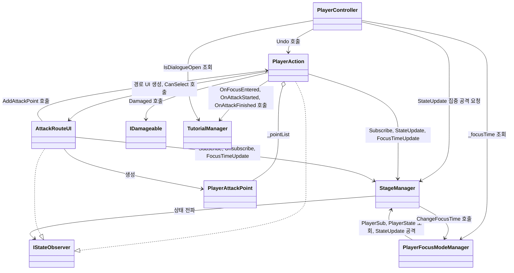

# PlayerAttack

## 기능 개요

### 기능 정의

- 플레이어의 집중(공격 경로 예약)부터 공격(예약 경로 순차 실행)까지 담당하는 시스템
- 플레이어 입력에 따른 상태 전환 요청, 집중 게이지 관리, 공격 경로 지정·취소, 경로를 따라가는 순간 이동 공격과 그 결과 처리(적 피해 / 응징 전환 / 벽 충돌) 담당
- 게임 상태 정의·전파는 시스템 외부의 `StageManager`, `IStateObserver`, `GameState`에서 담당 ([GameState](./GameState.md) 문서 참고)
- 응징 상태에서 플레이어를 감지해 사망 처리하는 판정과, 적 처치 시 집중 게이지 반환은 적 클래스(`RangedEnemyController`, `MeleeEnemyController` 등)에서 담당 ([Enemy](./Enemy.md), [Boss](./Boss.md) 문서 참고)

### 주요 동작

- 집중 입력 시 집중 게이지가 1 이상일 때만 집중 상태 전환 요청. 튜토리얼 대사가 열려 있으면 무시
- 집중 진입 시 플레이어 위치에 공격 경로 UI(`AttackRouteCanvas` 프리팹) 생성. 마우스 위치를 바닥 평면에 투영해 방향과 거리(최대 `_maxDistance`)를 표시
- 좌클릭으로 경로를 확정하면 집중 게이지가 변화하고, 확정 지점에 다음 경로 UI를 생성해 연속 예약. 확정 전에 게이지 잔량은 검사하지 않음
- 취소(Undo) 입력 시 마지막 예약 경로를 제거하고 집중 게이지를 반환하며, 직전 경로 UI를 다시 선택 가능 상태로 전환
- 집중 게이지는 기본 상태에서 충전되고 집중 상태에서 감소. 집중 중 0이 되면 자동으로 공격 상태 전환 요청
- 공격 상태 진입 시 예약 경로가 없으면 즉시 기본 상태로 복귀하고, 있으면 예약 순서대로 구간별 이동 공격 실행
- 구간마다 `Physics.Raycast`로 벽을 검사해 도착 위치를 보정하고, `Physics.SphereCastAll`로 경로상의 적을 검사한 뒤 `Transform`을 직접 변경해 이동
- 구간에서 적을 맞히면 공격 포즈 후 각 적의 `IDamageable.Damaged()` 호출, 맞히지 못하면 응징 상태 전환 요청
- 벽에 막힌 구간에서는 벽이 `IDamageable`이면 `Damaged()`를 호출하고 남은 경로를 실행하지 않음
- 구간 사이 대기 시간은 구간마다 0.2초씩 줄어들며 최솟값은 0.1초
- 공격 종료 0.3초 후 경로 UI를 모두 제거하고 기본 상태 전환 요청
- 사망 상태 진입 시 공격 코루틴 중단, 경로 UI 제거, 1초 후 `Time.timeScale = 0`

### 클래스 설명

- `PlayerController` (`Assets/Scripts/Player/PlayerController.cs`):
    - `InputActionReference` 기반 입력을 받아 상태 전환 요청 또는 `PlayerAction` 호출

- `PlayerAction` (`Assets/Scripts/Player/PlayerAction.cs`):
    - 예약 경로 목록 관리, 경로 취소, 공격 코루틴 실행 및 결과 처리
    - `IStateObserver` 구현으로 상태 변경에 대응

- `PlayerAttackPoint` (`Assets/Scripts/Player/PlayerAttackPoint.cs`):
    - 예약 경로 한 지점의 `Transform`과 `Canvas` 참조를 담는 데이터 클래스

- `PlayerFocusModeManager` (`Assets/Scripts/Player/PlayerFocusModeManager.cs`):
    - 집중 게이지 충전·소모·증감 및 게이지 UI 갱신
    - 집중 중 게이지 소진 시 공격 상태 전환 요청

- `AttackRouteUI` (`Assets/Scripts/UI/AttackRouteUI.cs`):
    - 마우스 기반 공격 경로 지정·확정, 경로 UI 표시
    - 자신의 위치를 `PlayerAttackPoint`로 `PlayerAction`에 등록

- 시스템 외부 클래스 (참조만 함):
    - `StageManager` (`Assets/Scripts/StageManager.cs`) : 게임 상태 보관·전파, 집중 게이지 증감 중계 ([GameState](./GameState.md))
    - `IStateObserver` (`Assets/Scripts/IStateObserver.cs`), `GameState` (`Assets/Scripts/Core/GameState.cs`) : 상태 구독 인터페이스와 상태 열거형 ([GameState](./GameState.md))
    - `IDamageable` (`Assets/Scripts/Enemy/IDamageable.cs`) : 공격 대상(적, 파괴 가능한 벽)의 피해 처리 인터페이스
    - `TutorialManager` (`Assets/Scripts/Tutorial/TutorialManager.cs`) : 튜토리얼 진행 콜백 수신 ([Tutorial](./Tutorial.md))

## 클래스 설계 및 구조

#### `PlayerController`

- 형태 : `MonoBehaviour`. `PlayerAction`, `PlayerFocusModeManager`와 같은 오브젝트에 있어야 함 (`GetComponent`로 참조)
- 필드
    - `_focusAction`, `_attackAction`, `_undoAction`, `_cameraFocusOnMe`, `_pause` : `OnEnable`에서 `Enable()` 후 `performed`에 콜백 연결, `OnDisable`에서 해제
    - `_directionAction`, `_distanceAction` : `Enable()` / `Disable()`만 하며 연결된 콜백 없음
- 메서드
    - `FocusState(InputAction.CallbackContext)` (private) : `TutorialManager.Instance.IsDialogueOpen`이면 무시, `PlayerFocusModeManager._focusTime < 1f`이면 무시, 그 외 `StateUpdate(GameState.집중)` 요청
    - `AttackState(InputAction.CallbackContext)` (private) : 조건 없이 `StateUpdate(GameState.공격)` 요청. 실제 전환 여부는 `StageManager`가 판단 (집중 상태에서만 전환)
    - `Undo(InputAction.CallbackContext)` (private) : `PlayerAction.Undo()` 호출

#### `PlayerAction`

- 형태 : `MonoBehaviour`, `IStateObserver` 구현
- 필드
    - `_pointList` (`List<PlayerAttackPoint>`) : 예약 경로 목록. `0`번은 집중 진입 시 플레이어 위치에 생성된 경로 UI이며, 실제 이동은 `1`번부터. 마지막 요소는 현재 선택 중인(아직 확정되지 않은) 경로 UI
    - `_waitTime` / `_wait` : 구간 사이 대기 시간과 그 `WaitForSeconds` 캐시. `Init()`에서 `_wait` 생성, 구간마다 `_waitTime`을 줄이고 `_wait`를 새로 생성
    - `_wallLayer`, `_enemyLayer` : 벽 검사(`ScanRoute`)와 적 검사(`ScanEnemy`)에 쓰는 레이어 마스크
    - `_timeValue` : `Undo()` 시 집중 게이지 증감량 (Player.prefab 값 `1`)
    - `_attackRouteCanvas` : 집중 진입 시 생성하는 경로 UI 프리팹 (`AttackRouteCanvas`)
    - `_Idle`, `_Attack[]` : 대기 / 공격 포즈 오브젝트. 공격 포즈는 `_Attack` 중 하나를 무작위로 활성화
- 메서드
    - `AddAttackPoint(PlayerAttackPoint point)` (public) : `AttackRouteUI`가 생성될 때 호출해 경로 지점을 목록 끝에 추가
    - `FocusState()` (public) : 튜토리얼 콜백 후 `_attackRouteCanvas`를 플레이어 위치(y = 0)·회전으로 생성, 눈 연출(`_eyeFire.DOFillAmount`, 0.5초) 시작
    - `AttackState()` (public) : `_pointList.Count <= 1`(확정된 경로 없음)이면 `ResetAttack()` 후 `StateUpdate(GameState.기본)`, 아니면 `Attack()` 코루틴 시작
    - `Attack()` (private, 코루틴) : 구간별 벽·적 검사, 이동, 결과 처리. 세부 순서는 `실행 절차 흐름` 참고
    - `ScanRoute(Vector3 nextPoint, out Vector3 hitPosition, out bool isWallExist, out RaycastHit wall)` (private) : 플레이어 위치 + `(0, 1, 0)`에서 다음 지점 방향으로 `_wallLayer` 대상 `Physics.Raycast`. 벽이 있으면 `hit.point + hit.normal * 0.7f`를 플레이어 높이로 맞춘 위치를 도착 위치로 반환, 없으면 다음 지점을 그대로 반환
    - `ScanEnemy(Vector3 nextPoint, out RaycastHit[] hits)` (private) : 현재 위치에서 `ScanRoute`가 반환한 도착 위치까지 반경 `0.6f`의 `Physics.SphereCastAll`로 `_enemyLayer` 대상 검사. 벽 보정 후 위치까지만 검사하므로 벽 뒤의 적은 대상에서 제외
    - `Undo()` (public) : 집중 상태이고 `_pointList.Count > 1`일 때만 동작. `FocusTimeUpdate(_timeValue)` → 마지막 경로 UI 오브젝트 `Destroy` → `RemoveAt` → 새 마지막 경로 UI의 `AttackRouteUI.CanSelect()` 호출
    - `ResetAttack()` (private) : `_pointList.Count < 1`이면 아무것도 하지 않고 반환(`_waitTime`도 재설정하지 않음). 그 외에는 모든 경로 UI 오브젝트 `Destroy`, `_waitTime = 1f`, 목록 비움. `_wait`는 다시 생성하지 않음. 호출처는 `AttackState()`(확정 경로 없음), `Attack()` 종료, `DeadState()`, `StopAttack()`
    - `DeadState()` (public) : `StopAllCoroutines()`, `ResetAttack()` 후 `TimeStop()` 코루틴으로 1초 뒤 `Time.timeScale = 0f`
    - `StopAttack()` (public) : `_attackCoroutine` 중단 후 `ResetAttack()`. 스크립트·씬·프리팹 검색 기준 호출처 없음
    - `PunishState()`, `ClearState()`, `Update()` : 빈 메서드

#### `PlayerAttackPoint`

- 형태 : 일반 C# 클래스 (`[Serializable]` 아님)
- 프로퍼티
    - `_transform` : 경로 UI 캔버스의 `Transform`. 위치는 경로 지점, 회전은 다음 지점을 향하는 방향(`AttackRouteUI.SetAttackRoute()`에서 갱신)이며, `Attack()`에서 플레이어 도착 회전으로 사용
    - `_attackPoint` : 같은 경로 UI의 `Canvas`. `Undo()`에서 `AttackRouteUI`를 찾는 데 사용

#### `PlayerFocusModeManager`

- 형태 : `MonoBehaviour`. `IStateObserver`를 구현하지 않고 `Update()`에서 `StageManager.PlayerState`를 직접 조회
- 필드 / 프로퍼티 (Player.prefab 값)
    - `_maxFocusTime` (`6`), `_focusTime` (초기 `3`), `_chargingSpeed` (`1.5`, `StageScene`·`TutorialScene`에서 `1`로 덮어씀), `_usingSpeed` (`0.5`)
    - `_focusTime` : 외부 읽기 전용. `PlayerController.FocusState()`가 진입 조건(`1f` 이상) 판단에 사용
- 메서드
    - `Start()` : `StageManager.PlayerSub(this)`로 자신을 등록. 이후 게이지 증감은 `StageManager.FocusTimeUpdate(float)` → `ChangeFocusTime(float)` 경로로 들어옴
    - `Update()` : 기본 상태면 `_chargingSpeed`로 충전, 집중 상태면 `_usingSpeed`로 감소하고 0 이하가 되면 `StateUpdate(GameState.공격)` 요청. 그 외 상태에서는 변화 없음
    - `UpdateFocusTime()` (private) : `0 ~ _maxFocusTime` 범위로 제한, `_timeImage.fillAmount` 갱신, `1f` 미만이면 빨간색 표시

#### `AttackRouteUI`

- 형태 : `MonoBehaviour`, `IStateObserver` 구현. `AttackRouteCanvas` 프리팹의 루트(`Canvas`와 같은 오브젝트)에 위치
- 필드 / 프로퍼티
    - `attackPoint` : 프리팹에서 자기 자신의 `AttackRouteUI`를 참조. 경로 확정 시 이 참조를 `Instantiate`해 다음 경로 UI 생성. `Instantiate` 시 계층 내부 참조는 복제본 자신으로 재연결되므로, 복제 대상은 프리팹 에셋이 아닌 현재 경로 UI 인스턴스(그 시점 상태 그대로)임 (Unity 엔진 동작 기반 분석, 에디터 미검증)
    - `_maxDistance` : 경로 한 구간의 최대 거리 (프리팹 값 `15`)
    - `_timeValue` : 경로 확정 시 집중 게이지 증감량 (프리팹 값 `-1`)
    - `_isRotate` : `true`인 동안 `Update()`에서 마우스를 따라 경로 지정
    - `_isSelectNow` : 현재 선택 중인 경로 UI 여부. 공격 진입 시 이 UI의 거리·지점 이미지를 숨기는 데 사용
- 메서드
    - `CacheComponents()` (private, `Start`에서 호출) : `StageManager.Subscribe(this)`, `GameObject.Find("Ground")`, `GameObject.Find("Player")`로 `PlayerAction` 획득, 거리 이미지 높이를 `_maxDistance`로 설정, `AttackPointSave()`로 자기 위치 등록
    - `AttackPointSave()` (public) : 자기 `Transform`과 `Canvas`로 `PlayerAttackPoint`를 만들어 `PlayerAction.AddAttackPoint()` 호출
    - `SetAttackRoute()` (public) : `Camera.main.ScreenPointToRay(Input.mousePosition)`과 `Ground` 높이의 `Plane.Raycast`로 마우스 월드 좌표 계산. 지점 이미지를 `_maxDistance` 이내로 제한해 배치하고 캔버스를 마우스 방향으로 회전. `Input.GetMouseButtonDown(0)`이면 `ConfirmAttackRout()` 호출
    - `ConfirmAttackRout()` (private) : `FocusTimeUpdate(_timeValue)` → 지점 이미지 위치(y = 0)에 다음 경로 UI 생성 → 자신의 선택 상태 해제, 새 UI의 `_isRotate = true`
    - `CanSelect()` (public) : `Undo()`로 다시 마지막이 된 경로 UI를 선택 가능 상태로 되돌림
    - `AttackState()` (public) : 선택 중인 UI면 거리·지점 이미지 숨김, 모든 UI의 `_isRotate = false`
    - `OnDestroy()` : `StageManager.Unsubscribe(this)`

### 클래스 간 관계도

### 실행 절차 흐름

#### 초기화

1. `PlayerController.Awake()`에서 `PlayerAction` 참조, `OnEnable()`에서 입력 액션 활성화 및 콜백 연결
2. `PlayerAction.Awake()` → `Init()`에서 `_wait` 생성, 공격 포즈·눈 연출 비활성화
3. `PlayerAction.OnEnable()`에서 `StageManager.Instance.StateUpdate(GameState.기본)` 호출
4. `PlayerAction.Start()` → `CacheComponents()`에서 `StageManager.Subscribe(this)`
5. `PlayerFocusModeManager.Start()`에서 `StageManager.PlayerSub(this)` 후 게이지 UI 갱신

#### 집중 진입 및 경로 예약

1. `PlayerController.FocusState()` : 튜토리얼 대사·게이지(`1f` 미만) 조건 확인 후 `StateUpdate(GameState.집중)`
2. `StageManager.StateUpdate()` : 기본 상태일 때만 집중으로 전환하고 구독자의 `FocusState()` 호출
3. `PlayerAction.FocusState()` : 플레이어 위치에 `AttackRouteCanvas` 생성, 눈 연출 시작
4. 생성된 `AttackRouteUI.Start()` → `CacheComponents()` : 상태 구독, `AttackPointSave()`로 자기 위치를 `_pointList`에 추가 (`0`번 = 출발 위치)
5. `AttackRouteUI.Update()` : `_isRotate`인 동안 `SetAttackRoute()`로 방향·거리 표시
6. 좌클릭 시 `ConfirmAttackRout()` : `FocusTimeUpdate(_timeValue)` → 확정 지점에 새 경로 UI 생성 → 새 UI가 4~5단계를 반복
7. `PlayerFocusModeManager.Update()` : 집중 상태 동안 게이지 감소, 0 이하가 되면 `StateUpdate(GameState.공격)`

#### 경로 취소 (Undo)

1. `PlayerController.Undo()` → `PlayerAction.Undo()`
2. 집중 상태가 아니거나 `_pointList.Count <= 1`이면 종료
3. `FocusTimeUpdate(_timeValue)`로 게이지 반환
4. 마지막 경로 UI(선택 중인 UI) 오브젝트 `Destroy`, 목록에서 제거
5. 새 마지막 경로 UI의 `CanSelect()` 호출 → 직전 확정 경로를 다시 지정할 수 있는 상태로 복귀

#### 공격 실행

1. 공격 입력(`PlayerController.AttackState()`) 또는 게이지 소진으로 `StateUpdate(GameState.공격)`. `StageManager`는 집중 상태일 때만 전환하고 구독자의 `AttackState()`를 `Subscribe` 등록 순서대로 호출. `PlayerAction`은 씬 시작 시 `Start()`에서, `AttackRouteUI`는 집중 진입 후 생성된 인스턴스의 `Start()`에서 구독하므로 `PlayerAction`이 항상 먼저 호출됨 (코드 분석 기준)
2. `PlayerAction.AttackState()` : 눈 연출 비활성화
    - `_pointList.Count <= 1`(확정 경로 없음)이면 `ResetAttack()` 후 `StateUpdate(GameState.기본)`. 이 호출 안에서 전체 구독자의 `IdleState()`가 먼저 실행됨 (`주의사항`의 `공격 상태 알림 도중 기본 상태 전환` 참고)
    - 아니면 `TutorialManager.OnAttackStarted()` 후 `Attack()` 코루틴 시작. 코루틴은 첫 `yield return _wait`까지 실행된 뒤 제어가 돌아옴
3. `AttackRouteUI.AttackState()` : 경로 지정 중단, 선택 중인 UI의 거리·지점 이미지 숨김. 2단계 이후에 호출되며, 이 순서 차이로 인한 런타임 동작 차이는 미검증
4. `Attack()` : `_wait` 대기 후 `i = 1`부터 마지막 지점까지 반복
    1. `ScanRoute(_pointList[i] 위치)` : 벽 검사, 도착 위치(`hitPosition`) 결정
    2. `ScanEnemy(hitPosition)` : 현재 위치 → 도착 위치 사이의 적 검사
    3. `transform.position = hitPosition`, `transform.rotation = _pointList[i - 1]` 회전
    4. `Physics.SyncTransforms()`
    5. 적이 있으면 `AttackPose()` 후 각 적의 `GetComponentInParent<IDamageable>().Damaged()`. 없으면 `IdleState()` → 0.05초 대기 → `StateUpdate(GameState.응징)` → 0.05초 대기
    6. 벽이 없고 마지막 지점이 아니면 `_wait` 대기 후 `_waitTime`을 0.2 감소(최소 0.1)시키고 `_wait` 재생성. 벽이 있으면 벽의 `IDamageable.Damaged()`(있는 경우) → `IdleState()` → 반복 종료
5. 반복 종료 후 0.3초 대기 → `ResetAttack()` → `TutorialManager.OnAttackFinished()` → `StateUpdate(GameState.기본)`

#### 응징 및 사망 연동 (구간에서 적을 맞히지 못한 경우)

1. `Attack()`에서 `StateUpdate(GameState.응징)` → 구독자의 `PunishState()` 호출 (`PlayerAction.PunishState()`는 빈 메서드)
2. 적 클래스의 `PunishState()` → `ShootAttackRay()`가 플레이어 방향 Raycast 실행. 플레이어가 감지되면 `PunishAttack()` → `StateUpdate(GameState.사망)` (시스템 외부, [Enemy](./Enemy.md) 문서 참고)
3. `StageManager.Die()` → `PlayerAction.DeadState()` : `StopAllCoroutines()`, `ResetAttack()`, 1초 후 `Time.timeScale = 0f`
4. 1~3단계는 모두 `Attack()` 코루틴 안의 `StateUpdate(GameState.응징)` 호출 한 번에서 동기적으로 이어지며, 제어가 `Attack()`으로 돌아온 뒤 다음 `yield`에서 코루틴이 멈춤 (코드 분석 기준)
5. 플레이어를 감지한 적이 없으면 상태는 응징으로 남고, `Attack()`은 다음 구간을 계속 실행한 뒤 마지막에 기본 상태를 요청

### 설계 결정 및 주의사항

#### 설계 결정

- `집중 중 Time.timeScale을 변경하지 않음` : 집중 상태에서 게임 전체 시간을 멈추면 시간에 영향을 받는 다른 동작도 멈추므로, 플레이어의 경로 예약과 UI 연출을 유지하기 위해 시간 정지 대신 각 객체가 상태 조건으로 동작을 제어하도록 했다. 이 시스템에서는 `AttackRouteUI.Update()`의 경로 지정과 `PlayerFocusModeManager`의 `Time.deltaTime` 기반 게이지 감소가 집중 상태에서 동작한다. (근거 : `.claude/reference.md` 02)

- `예약 경로를 List로 관리` : 예약 순서대로 실행하면서 마지막 예약만 취소할 수 있도록, 순서가 유지되고 인덱스로 접근 가능한 `List<PlayerAttackPoint>`를 사용했다. 취소는 `RemoveAt(Count - 1)`로 처리한다. (근거 : `.claude/reference.md` 03)

- `공격을 코루틴으로 순차 실행` : 각 구간의 실행 순서와 대기 시간을 관리하고, 공격 도중 사망 같은 상태 변경에 대응할 수 있도록 코루틴을 사용했다. 사망 시 `DeadState()`의 `StopAllCoroutines()`로 남은 공격을 중단한다. (근거 : `.claude/reference.md` 03)

- `연속 공격 시 대기 간격 감소` : 연속 공격의 속도감을 위해 구간마다 대기 시간을 줄인다. (근거 : `.claude/reference.md` 03)

- `Rigidbody 이동 대신 Transform 직접 변경` : Rigidbody의 물리 충돌 반응으로 돌진이 중간에 멈추거나 경로가 바뀌는 상황을 피하고 예약된 좌표로 정확히 이동하기 위해 `transform.position`을 직접 변경한다. 이 과정에서 생기는 Collider 위치 차이는 `Physics.SyncTransforms()`로 동기화한다. (근거 : `.claude/reference.md` 04)

- `Physics.SyncTransforms()를 구간 이동 직후 호출` : 구간 안에서 응징 상태로 전환될 때 적 Raycast가 이동한 플레이어 위치를 쓰도록, 위치·회전 대입 직후 매 구간 동기화한다. (근거 : 사용자 확인, `Docs/Docs_Report/PlayerAttack/Dev_20261126_SyncTransformsFix.md`)
    - 위 내용은 설계 의도이며, 현재 코드에서의 효과는 미검증이다. 현재 코드는 이동과 `StateUpdate(GameState.응징)` 사이에 `IdleState()` 후 `WaitForSeconds(0.05f)` 대기가 있고 Fixed Timestep이 `0.02`(`ProjectSettings/TimeManager.asset`)이므로, 이 대기 중 물리 시뮬레이션 단계에서 Transform이 자동으로 물리 엔진에 반영될 수 있다 (엔진 동작 기반 분석, 미검증).

- `벽 검사(Raycast)와 적 검사(SphereCastAll) 분리` : Raycast로 장애물 충돌 위치를 먼저 계산해 도착 위치를 정하고, SphereCastAll로 일정 폭을 가진 돌진 경로상의 여러 적을 따로 탐색해 이동과 공격 판정을 독립적으로 처리한다. 충돌 이벤트에 의존하지 않고 이동 전에 결과를 결정한다. (근거 : `.claude/reference.md` 04)

- `집중 게이지 도입` : 보스전 플레이 테스트에서 집중 상태에 제한이 없으면 공격 경로를 연속으로 지정하는 것만으로 쉽게 클리어되는 문제가 확인되어, 초기 기획에 없던 집중 게이지를 추가했다. 플레이어가 제한된 자원 안에서 공격 경로를 계획하도록 하기 위함이다. 코드상으로는 진입 조건(`1f` 이상), 집중 중 감소와 소진 시 자동 공격, 경로 확정 시 소모, 취소 시 반환으로 구현되어 있다. (근거 : `.claude/reference.md` 프로젝트 회고)

#### 주의사항

- `Physics.SyncTransforms() 호출 위치 유지` : 프로젝트 설정이 `m_AutoSyncTransforms: 0`(`ProjectSettings/DynamicsManager.asset`)이고, `Physics.SyncTransforms()`는 `Attack()` 루프 안 위치·회전 대입 직후 1곳에서만 호출된다 (코드 확인). 자동 동기화가 꺼진 상태에서 `Transform`을 직접 바꾼 뒤 동기화 호출이나 물리 시뮬레이션 단계 전에 실행되는 물리 쿼리는 이전 Collider 위치를 사용한다 (Unity 엔진 동작 기반 서술, 실행 미검증). 다만 현재 코드는 이동 후 `WaitForSeconds(0.05f)` 대기 뒤에 응징으로 전환하므로, 그 사이 물리 스텝으로 자동 동기화될 수 있어 호출을 옮겼을 때 응징 시 적 Raycast 판정이 실제로 달라지는지는 미검증이다. `Attack()`에서 플레이어 위치를 바꾸는 코드를 추가하거나 응징 전 대기를 바꿀 때는 동기화 시점을 함께 확인해야 한다.

- `응징 전환은 동기 호출 체인` : `StateUpdate(GameState.응징)` 호출 안에서 적의 판정 → 사망 전환 → `PlayerAction.DeadState()`의 `ResetAttack()`까지 이어질 수 있어, 제어가 `Attack()`으로 돌아온 시점에 `_pointList`가 이미 비어 있을 수 있다. 현재는 바로 다음 문장이 `yield`라 목록에 접근하지 않는다. 응징 전환 직후에 `_pointList`를 참조하는 코드를 추가하면 인덱스 오류가 생길 수 있다. (코드 분석 기준, 미검증)

- `_waitTime 초기값과 _wait 갱신 불일치` : Player.prefab의 `_waitTime`은 `0.6`이고 `Init()`에서 이 값으로 `_wait`를 만든다. `ResetAttack()`은 `_pointList.Count >= 1`일 때 `_waitTime = 1f`로 되돌리지만 `_wait`는 다시 만들지 않는다. `ResetAttack()`은 `Attack()` 종료뿐 아니라 `AttackState()`의 확정 경로 없음 분기(`Count == 1`이면 재설정됨)와 `DeadState()`에서도 호출되므로, 공격 실행 여부와 관계없이 첫 `ResetAttack()` 실행 이후의 공격부터는 첫 대기와 첫 구간 대기에 그 시점의 `_wait` 값이 쓰이고, 그 다음 구간부터 `1f`에서 줄어든 값(0.8초~)이 쓰인다. 예를 들어 집중 후 경로를 확정하지 않고 공격으로 전환하면 `_waitTime`만 `1f`가 되므로, 다음 첫 실제 공격은 `_wait`(0.6초)로 대기한 뒤 이후 구간에 0.8초부터 적용된다. 대기 시간을 조정할 때 세 곳(`_waitTime` 직렬화 값, `ResetAttack()`, `Attack()` 감소 로직)을 함께 확인해야 한다. (코드 분석 기준, 에디터 미검증)

- `하드코딩 수치` : 벽 표면 보정 거리 `0.7f`, 적 검사 반경 `0.6f`, 벽 검사 Ray 높이 `1f`, 대기 감소량 `0.2f`·최솟값 `0.1f`, 응징 전후 대기 `0.05f`, 종료 대기 `0.3f`, 사망 후 정지 대기 `1f`가 코드에 직접 들어 있다. 집중 진입 기준 `1f`는 `PlayerController.FocusState()`와 `PlayerFocusModeManager.UpdateFocusTime()`(빨간색 표시 기준) 두 곳에 따로 있어, 기준을 바꿀 때 둘을 함께 바꿔야 표시와 실제 조건이 일치한다.

- `오브젝트 이름 의존` : `AttackRouteUI.CacheComponents()`는 `GameObject.Find("Ground")`, `GameObject.Find("Player")`로 대상을 찾는다. 씬의 오브젝트 이름이 바뀌면 경로 UI가 `NullReferenceException`으로 동작하지 않는다.

- `구 Input API 사용` : `AttackRouteUI`는 `Input.mousePosition`, `Input.GetMouseButtonDown(0)`을 사용한다. 현재 `activeInputHandler: 2`(Both)라 동작하지만, Active Input Handling을 Input System 전용으로 바꾸면 경로 지정·확정이 동작하지 않는다. `TechSpec.md`의 `유저 입력 시스템`은 구 `InputManager`를 사용하지 않도록 정하고 있어, 이 구현은 규칙 문서와 다르다.

- `적 피해 처리의 null 미검사` : `Attack()`은 적중한 적마다 `hits[j].transform.GetComponentInParent<IDamageable>().Damaged()`를 반환값 검사 없이 호출한다. `_enemyLayer`에 속하지만 부모 계층에 `IDamageable`이 없는 콜라이더를 맞히면 `NullReferenceException`이 발생하고 공격 코루틴이 중단된다 (코드 분석 기준, 미검증). 벽 쪽은 `TryGetComponent`로 검사한다. `_enemyLayer`에 오브젝트를 추가할 때는 `IDamageable` 구현 여부를 확인해야 한다.

- `공격 상태 알림 도중 기본 상태 전환` : 확정 경로가 없을 때 `PlayerAction.AttackState()`는 `StageManager`의 `AttackState()` 순회 도중 `StateUpdate(GameState.기본)`을 호출한다. 순회가 재개되면 `PlayerAction`보다 뒤에 등록된 구독자는 `IdleState()`를 받은 뒤 `AttackState()`를 받으며, 이때 `PlayerState`는 이미 `기본`이다. 대상에는 `AttackRouteUI`가 항상 포함되고, `CameraController`, `UIController`, `StateTextureChanger`의 포함 여부는 씬 오브젝트 간 `Start` 순서에 달려 코드로 확정할 수 없다 (코드 분석 기준, 영향 미검증). 구독자의 `AttackState()`에 상태 의존 동작을 추가할 때 이 순서를 고려해야 한다.

- `구성 요소 위치 의존` : `PlayerController`는 `GetComponent<PlayerAction>()`, `_playerAction.GetComponent<PlayerFocusModeManager>()`로 참조하므로 세 컴포넌트가 같은 오브젝트에 있어야 한다. `PlayerFocusModeManager`는 `StageManager.PlayerSub()`로 한 개만 등록되며, 등록 전에 `FocusTimeUpdate()`가 호출되면 `NullReferenceException`이 발생한다.

- `OnEnable에서 StageManager.Instance 접근` : `PlayerAction.OnEnable()`은 `StageManager.Instance`에 바로 접근한다. 스크립트 실행 순서가 별도로 지정되어 있지 않아(`.meta`의 `executionOrder` 없음) `StageManager.Awake()`가 먼저 실행된다는 보장은 코드상 없다. (코드 분석 기준, 미검증)

## 주요 이슈 및 디버깅 사례

### `응징 시 적 Raycast가 이동한 플레이어를 감지하지 못한 문제`

#### 발생문제

- 이동 공격 후 적 처치에 실패해 응징 상태가 되었을 때, 적이 쏜 Raycast가 플레이어를 감지하지 못함
- `Debug.DrawRay`로는 Ray가 플레이어를 향하고 있었으나 물리 판정에서는 충돌이 감지되지 않음

#### 원인 분석

- 플레이어 위치가 바뀌지 않은 경우, 또는 이동 후 코루틴으로 적 Raycast 실행을 늦춘 경우에는 정상 감지되는 것을 확인 (회고 기록)
- `Transform.position`을 직접 바꾼 직후에는 물리 엔진의 Collider 위치에 반영되지 않은 상태에서 적 Raycast가 실행된 것이 원인. 프로젝트 설정 `m_AutoSyncTransforms: 0`으로 자동 동기화가 꺼져 있음

#### 해결 방법

- Raycast 실행을 늦추는 방식은 플레이 속도감에 영향을 줄 수 있어 채택하지 않고, 이동 직후 `Physics.SyncTransforms()`를 호출해 Transform 변경을 물리 엔진에 반영하도록 수정 (근거 : `.claude/reference.md` 04)
    - 현재 코드에는 이동과 응징 전환 사이에 `WaitForSeconds(0.05f)` 지연이 있다. 이 지연과 위의 "지연 방식 미채택" 서술의 관계(추가 시점, 이 문제와의 관련 여부)는 기록과 코드 어느 쪽에서도 확인되지 않음 (미검증)
- 이후 다른 수정 과정에서 이 호출이 루프 안 이동 직후에서 `Attack()` 루프 종료 후로 잘못 옮겨졌음 (사용자 확인). 이 위치에서는 루프 안의 응징 전환 시점보다 동기화가 늦음 (코드 분석)
- 2026-11-26 호출 위치를 루프 안 `transform.position` / `transform.rotation` 대입 직후로 되돌리고, 루프 종료 후 호출은 제거 (`Docs/Docs_Report/PlayerAttack/Dev_20261126_SyncTransformsFix.md`, 리뷰 통과 `Review_20261126_SyncTransformsFix.md`)

#### 검증 결과

- 최초 `Physics.SyncTransforms()` 적용 후 적 Raycast가 플레이어를 정상 감지한 것은 회고 기록 기준
- 2026-11-26 수정은 코드 위치만 확인됨. 수정 후 응징 상태에서 적이 이동한 플레이어를 감지하는지, 컴파일 여부, 응징 전후 `WaitForSeconds(0.05f)`와 이 문제의 관련성은 유니티 에디터에서 미검증

### `공격 도중 클리어 후 클리어 UI가 사라지는 문제`

#### 발생문제

- 예약 경로로 연속 공격하는 도중 보스를 처치해 클리어 상태가 되었는데, 남은 공격이 계속 실행되어 게임 상태가 다시 바뀌고 클리어 UI가 사라짐

#### 원인 분석

- `Attack()` 코루틴은 종료 시 무조건 `StateUpdate(GameState.기본)`을 호출하는 구조여서, 클리어 이후에도 상태가 기본으로 덮어써짐

#### 해결 방법

- 시스템 외부인 `StageManager.StateUpdate()`에서 현재 상태가 클리어이면 클리어 외의 전환 요청을 무시하도록 수정 (근거 : `.claude/reference.md` 03, 현재 코드에서 해당 조건 확인)
- `PlayerAction.Attack()`의 종료 시 기본 상태 요청은 그대로 유지됨

#### 검증 결과

- 클리어 이후 다른 상태 변경 요청이 와도 클리어 상태가 유지되어 클리어 UI가 사라지지 않음 (회고 기록 기준, 이번 문서 작성 중 에디터 재검증은 하지 않음)
