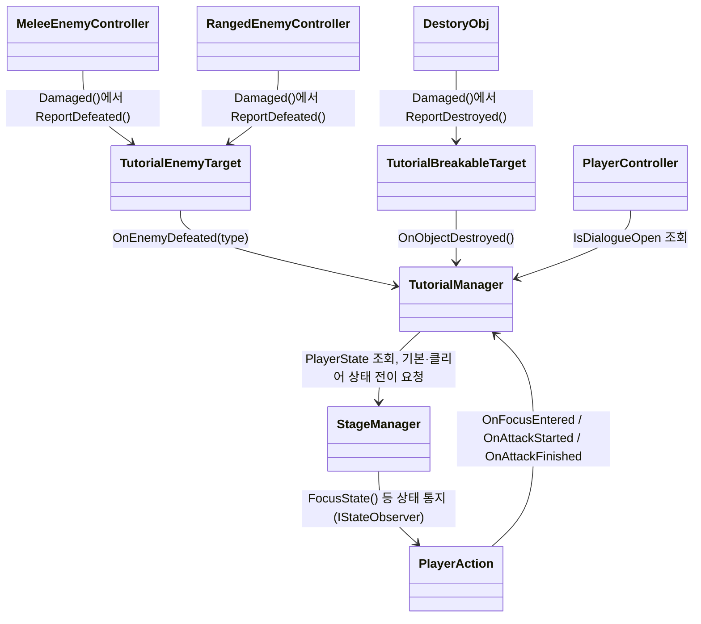

# Tutorial

## 기능 개요

### 기능 정의

- TutorialScene에서 3개 파트로 나뉜 튜토리얼 진행을 담당하는 시스템
- 파트별 대사·가이드 UI 표시, 파트별 완료 조건 판정, 파트 전환과 체크포인트 관리
- 플레이어 상태 보관·전이(`기본`/`집중`/`공격`/`클리어` 등)는 `StageManager`([GameState](./GameState.md)), 집중·공격 실행은 `PlayerAction`([PlayerAttack](./PlayerAttack.md)), 적 처치 처리는 각 적 컨트롤러([Enemy](./Enemy.md)), 오브젝트 파괴 처리는 `DestoryObj`가 담당
- 튜토리얼 시스템은 `PlayerAction`·적 컨트롤러·`DestoryObj`로부터 집중 진입·공격·처치·파괴 통지를 받음
- `StageManager`로부터는 상태 통지를 받지 않으며, 튜토리얼 시스템이 `StageManager.PlayerState`를 직접 조회하고 `기본`·`클리어` 상태 전이를 직접 요청

### 주요 동작

- 파트 시작 시 해당 파트의 오브젝트 묶음(`_partRoots`)만 활성화하고, 플레이어를 파트 시작 지점(`_spawnPoints`)으로 이동
- 파트 시작 시 대사 UI를 표시하고 Enter 키 입력을 대기하며, 대기 중에는 `PlayerController`가 집중 상태 진입 입력을 무시
- Enter 키 입력 시 대사 UI를 닫고 해당 파트의 가이드 UI를 표시
- 파트별 완료 조건
    - 파트 1 (`_part == 0`) : 집중 상태 진입 1회 + `First` 타입 적 처치
    - 파트 2 (`_part == 1`) : 파괴 가능 오브젝트 파괴 + `Part2` 타입 적 2기 처치
    - 파트 3 (`_part == 2`) : `Moving` 타입 적 처치 + `Archer` 타입 적 처치
- 완료 조건 판정은 `StageManager.PlayerState`가 `기본`일 때만 수행
- 파트 1·2 완료 시 다음 파트로 전환, 파트 3 완료 시 `StageManager`에 `클리어` 상태를 요청
- 파트 1·2 완료 시 다음 파트 번호, 파트 3 완료 시 `0`, `RetryCurrentPart()` 호출 시 현재 파트 번호를 static 체크포인트로 보관하여, 같은 씬을 다시 로드하면 마지막으로 도달한 파트부터 시작

### 클래스 설명

- `TutorialManager` (`Assets/Scripts/Tutorial/TutorialManager.cs`):
    - 튜토리얼 파트 진행, 완료 조건 판정, 대사·가이드 UI 전환, 체크포인트 관리
    - 같은 파일에 적 분류용 `TutorialEnemyType` 열거형 정의
- `TutorialEnemyTarget` (`Assets/Scripts/Tutorial/TutorialEnemyTarget.cs`):
    - 튜토리얼 적에 부착되어 적의 분류(`TutorialEnemyType`)를 보관하고, 처치 사실을 `TutorialManager`에 1회 통지
- `TutorialBreakableTarget` (`Assets/Scripts/Tutorial/TutorialBreakableTarget.cs`):
    - 파트 2의 파괴 가능 오브젝트에 부착되어 파괴 사실을 `TutorialManager`에 1회 통지

- 다른 시스템 소속으로, 튜토리얼 시스템과 연동하는 클래스
    - `PlayerAction` (`Assets/Scripts/Player/PlayerAction.cs`, [PlayerAttack](./PlayerAttack.md)) : 집중 진입·공격 시작·공격 종료 통지
    - `PlayerController` (`Assets/Scripts/Player/PlayerController.cs`, [PlayerAttack](./PlayerAttack.md)) : 대사 표시 중 집중 입력 차단
    - `MeleeEnemyController` (`Assets/Scripts/Enemy/MeleeEnemyController.cs`), `RangedEnemyController` (`Assets/Scripts/Enemy/RangedEnemyController.cs`) ([Enemy](./Enemy.md)) : 피격 시 `TutorialEnemyTarget.ReportDefeated()` 호출
    - `DestoryObj` (`Assets/Scripts/DestoryObj.cs`) : 피격 시 `TutorialBreakableTarget.ReportDestroyed()` 호출
    - `StageManager` (`Assets/Scripts/StageManager.cs`, [GameState](./GameState.md)) : 플레이어 상태 보관 및 상태 전이. `TutorialManager`가 상태를 조회하고 전이를 요청하는 대상

## 클래스 설계 및 구조

#### `TutorialManager`

- 형태 : `MonoBehaviour`, static 프로퍼티 `Instance`로 접근
    - `Awake()`에서 `Instance = this`로 덮어쓰며, 중복 인스턴스 검사는 하지 않음
    - `OnDestroy()`에서 자신이 `Instance`인 경우에만 `null`로 해제
- 열거형 `TutorialEnemyType` : `First`, `Part2`, `Moving`, `Archer`
    - 각 값이 특정 파트의 완료 조건에 대응하며, 해당 파트가 아닐 때 받은 통지는 무시
- static 필드
    - `s_checkpoint` : 씬 재로드 후 시작할 파트 번호. 파트 1·2 완료 시 `_part + 1`, 파트 3 완료 시 `0`, `RetryCurrentPart()` 호출 시 현재 `_part`로 설정
    - `s_checkpointScene` : 체크포인트를 기록한 씬 이름. `Awake()`에서 현재 활성 씬 이름과 다르면 `s_checkpoint`를 `0`으로 초기화
- 직렬화 필드
    - `_partRoots`, `_spawnPoints`, `_dialogues`, `_guides` : 파트 번호(`0 ~ 2`)를 인덱스로 사용하는 배열
    - `_player` : 파트 시작 시 `_spawnPoints[part]`로 이동시킬 플레이어 `Transform`. `null`이면 `BeginPart()`의 플레이어·카메라 이동을 건너뜀
    - `_camera` : 파트 시작 시 위치를 플레이어 위치로 맞출 카메라 오브젝트
    - `_guidePanel` : 파트 완료 시 비활성화되는 가이드 패널
    - `_dialoguePanel`, `_dialogueText`, `_guideText` : 직렬화만 되어 있고 코드에서 사용하지 않음
- 상태 필드
    - `_waitingForNext` : 대사 표시 중(Enter 대기) 여부. `true`인 동안 완료 판정과 적·오브젝트 통지를 무시
    - `_complete` : 파트 3 완료 여부. `true`가 되면 이후 판정과 통지를 무시
    - `_attackInProgress` : `OnAttackStarted()`/`OnAttackFinished()`에서 값을 바꾸지만, 이 값을 읽는 코드는 없음
- 프로퍼티
    - `IsDialogueOpen` : `_waitingForNext`를 그대로 반환. `PlayerController.FocusState()`가 집중 입력 차단 여부 판단에 사용
- 메서드
    - `Update()` : 아래 두 가지를 매 프레임 수행
        - `_waitingForNext`가 `true`이고 `Return` 또는 `KeypadEnter` 키가 눌리면 `NextDialogue()` 호출 (구 `Input` API 사용)
        - `_waitingForNext`·`_complete`가 모두 `false`이고 `PlayerState == 기본`이면 `CheckCompletion()` 호출
    - `BeginPart(int part)` (private) : 진행 상태 필드를 모두 초기화하고, `_partRoots` 중 `part` 인덱스만 활성화한 뒤 플레이어·카메라 이동과 `ShowDialogue()` 수행
        - 플레이어·카메라 이동은 `_player != null`이고 `_spawnPoints[part]`가 존재(`part < _spawnPoints.Length`, `null` 아님)할 때만 수행하며, 조건이 맞지 않으면 이동 없이 `ShowDialogue()`만 수행
        - 플레이어 이동 시 `CharacterController`를 비활성화한 상태에서 위치·회전을 설정하고 `Physics.SyncTransforms()` 후 다시 활성화한 뒤, `_camera` 위치를 플레이어 위치로 설정
        - TutorialScene에는 `_player`와 `_spawnPoints` 3개가 모두 할당되어 있어 현재 씬 구성에서는 조건이 항상 충족됨
    - `NextDialogue()` : `_waitingForNext`가 `false`면 무시. 모든 대사·가이드를 숨긴 뒤 현재 파트의 가이드를 표시하고, `PlayerState`가 `기본`이 아니면 `기본`으로 상태 전이를 요청한 뒤 `CheckCompletion()` 호출
        - 코드 주석상 "대사 다음 버튼에 연결" 용도로 public이지만, 씬·프리팹에 버튼 이벤트로 연결된 기록은 없으며 현재는 `Update()`의 Enter 입력으로만 호출됨
    - `OnFocusEntered()` : `_part == 0`일 때만 `_focusEntered`를 `true`로 설정
    - `OnAttackFinished()` : `_attackInProgress`를 `false`로 바꾸고 `CheckCompletion()` 호출
    - `OnEnemyDefeated(TutorialEnemyType type)` : `_complete` 또는 `_waitingForNext`면 무시. 현재 파트와 `type`이 일치하는 조건만 갱신한 뒤 `CheckCompletion()` 호출
    - `OnObjectDestroyed()` : `_part == 1`이 아니거나 `_complete`/`_waitingForNext`면 무시. `_objectDestroyed`를 `true`로 설정한 뒤 `CheckCompletion()` 호출
    - `CheckCompletion()` (private) : `_waitingForNext`/`_complete`이거나 `PlayerState != 기본`이면 즉시 반환. 현재 파트의 완료 조건이 충족되면 `_guidePanel`을 끄고 파트 전환 또는 클리어 처리
    - `RetryCurrentPart()` : `Time.timeScale`을 `1`로 복구하고, `s_checkpoint`를 현재 파트로 설정한 뒤 현재 씬을 `buildIndex`로 다시 로드
    - `ResetProgress()` (static) : `s_checkpoint`를 `0`, `s_checkpointScene`을 `null`로 초기화

#### `TutorialEnemyTarget`

- 직렬화 필드 `_type` : 이 적의 `TutorialEnemyType`. 인스펙터에서 지정
- `ReportDefeated()` : `_reported` 플래그로 1회만 실행되며, `TutorialManager.Instance?.OnEnemyDefeated(_type)` 호출
    - `TutorialManager`가 통지를 무시한 경우(대사 표시 중 등)에도 `_reported`는 `true`가 되어 재통지되지 않음

#### `TutorialBreakableTarget`

- `ReportDestroyed()` : `_reported` 플래그로 1회만 실행되며, `TutorialManager.Instance?.OnObjectDestroyed()` 호출

### 클래스 간 관계도

### 실행 절차 흐름

#### 씬 시작과 파트 시작

1. `TutorialManager.Awake()` : `Instance` 등록. 활성 씬 이름이 `s_checkpointScene`과 다르면 `s_checkpoint = 0`으로 초기화하고 씬 이름 기록
2. `TutorialManager.Start()` : `BeginPart(Mathf.Clamp(s_checkpoint, 0, 2))` 호출
3. `BeginPart()` : 상태 필드 초기화 → `_partRoots[part]`만 활성화 → (`_player`와 `_spawnPoints[part]`가 유효한 경우에만) 플레이어를 `_spawnPoints[part]`로 이동, 카메라 위치를 플레이어 위치로 설정 → `ShowDialogue()`
4. `ShowDialogue()` : 모든 대사·가이드 비활성화 → `_dialogues[part]` 활성화 → `_waitingForNext = true`
5. 대기 중 `PlayerController.FocusState()`는 `IsDialogueOpen`이 `true`이므로 집중 상태 전이를 요청하지 않음
6. Enter 입력 → `Update()`에서 `NextDialogue()` → 대사 숨김, `_guides[part]` 활성화, `_waitingForNext = false`, 필요 시 `StageManager.StateUpdate(GameState.기본)` → `CheckCompletion()`

#### 플레이어 행동 통지와 완료 판정

1. 플레이어 집중 입력 → `StageManager.StateUpdate(집중)` → 구독자인 `PlayerAction.FocusState()`에서 `TutorialManager.Instance?.OnFocusEntered()` 호출
2. 공격 입력 → `StageManager.StateUpdate(공격)` → `PlayerAction.AttackState()`
    - 공격 지점이 1개 이하이면 튜토리얼 통지 없이 `기본` 상태로 복귀
    - 그 외에는 `OnAttackStarted()` 호출 후 `Attack()` 코루틴 시작
3. `Attack()` 코루틴 진행 중 적 피격 → `MeleeEnemyController.Damaged()` 또는 `RangedEnemyController.Damaged()` → `TutorialEnemyTarget.ReportDefeated()` → `TutorialManager.OnEnemyDefeated(type)`
    - 이 시점의 `PlayerState`는 `공격`, 또는 앞선 구간에서 적이 감지되지 않아 `StateUpdate(GameState.응징)`이 호출된 경우 `응징`일 수 있음. 어느 경우든 `기본`이 아니므로 `CheckCompletion()`은 조건 플래그만 갱신된 채 즉시 반환
4. 파괴 가능 오브젝트 피격 시 (`PlayerAction.Attack()`의 `IDamageable.Damaged()` 호출) `DestoryObj.Damaged()` → `TutorialBreakableTarget.ReportDestroyed()` → `TutorialManager.OnObjectDestroyed()` (3과 동일하게 판정은 보류)
5. 공격 종료 → `PlayerAction.Attack()`에서 `ResetAttack()` 후 `OnAttackFinished()` 호출 → 이후 `StageManager.StateUpdate(기본)`
    - `OnAttackFinished()` 호출 시점에는 아직 `PlayerState`가 `공격` 또는 `응징`(3과 같은 경우)으로 `기본`이 아니므로 이 호출의 `CheckCompletion()`도 판정하지 않음
    - `응징` 전이 이후 다른 구독자에 의한 추가 상태 전이 여부는 미검증
6. `PlayerState`가 `기본`이 된 뒤의 `TutorialManager.Update()`에서 `CheckCompletion()`이 실제 판정 수행

- 3 ~ 6의 판정 시점은 코드 분석 기준이며, 실행으로 검증한 기록은 없음

#### 파트 완료와 전환

1. `CheckCompletion()`에서 현재 파트 조건 충족 확인 → `_guidePanel.SetActive(false)`
2. 파트 1·2인 경우 : `_waitingForNext = true`, `s_checkpoint = _part + 1` → `BeginPart(_part + 1)`로 다음 파트 시작 (위 "씬 시작과 파트 시작"의 3 ~ 6 반복)
3. 파트 3인 경우 : `_complete = true`, `s_checkpoint = 0` → `StageManager.StateUpdate(GameState.클리어)`
    - 이후 클리어 처리는 `StageManager`의 구독자(`MainUIController.ClearState()` 등)가 담당

#### 재시작과 체크포인트

1. 씬이 다시 로드되면 `TutorialManager.Awake()`에서 같은 씬 이름이므로 `s_checkpoint` 유지
2. `Start()`에서 `s_checkpoint` 파트부터 `BeginPart()` 실행
- 씬 재로드 경로
    - `TutorialManager.RetryCurrentPart()` : 코드·씬·프리팹에서 호출처가 확인되지 않음
    - `GameManager.RetrySceneLoad()` : 현재 씬을 이름으로 다시 로드하므로 위 1 ~ 2와 같이 체크포인트가 유지됨 (코드 분석 기준)

### 설계 결정 및 주의사항

#### 주의사항

- `파트 수와 조건 수치 하드코딩` : 파트 수 3(`Mathf.Clamp(s_checkpoint, 0, 2)`, `_part == 2` 최종 판정), 파트별 조건(`switch`), 파트 2의 처치 수 `2`가 코드에 고정되어 있다. 파트를 추가하거나 처치 수를 바꾸려면 `CheckCompletion()`, `OnEnemyDefeated()`, `OnFocusEntered()`, `OnObjectDestroyed()`, `Start()`와 `TutorialEnemyType`을 함께 수정해야 한다. TutorialScene에는 현재 `First` 1기, `Part2` 2기, `Moving` 1기, `Archer` 1기의 `TutorialEnemyTarget`과 `TutorialBreakableTarget` 1개가 배치되어 있으며, 배치 수가 조건보다 적으면 파트가 완료되지 않는다.
- `인덱스 기반 배열 정합성` : `_partRoots`, `_spawnPoints`, `_dialogues`, `_guides`는 같은 파트 번호를 인덱스로 사용한다. 배열 순서를 바꾸면 파트와 오브젝트·UI의 대응이 어긋난다.
- `완료 판정은 PlayerState가 기본일 때만 수행` : 적 처치·오브젝트 파괴 통지는 대부분 `공격` 상태에서 들어오므로, 실제 판정은 `기본` 상태로 돌아온 뒤 `Update()`에서 이뤄진다. `StageManager`의 상태 이름이나 공격 종료 후 `기본` 복귀 흐름을 바꾸면 튜토리얼이 진행되지 않을 수 있다.
- `대사 표시 중 처리된 처치는 다시 집계되지 않음` : `_waitingForNext`가 `true`인 동안 들어온 `OnEnemyDefeated()`는 무시되지만, `TutorialEnemyTarget`과 `TutorialBreakableTarget`은 이미 `_reported = true`가 되어 다시 통지하지 않는다. 적 자체도 `Damaged()`에서 `Destroy`된다.
- `대사 표시 중 입력 차단 범위` : `IsDialogueOpen`으로 차단되는 것은 `PlayerController.FocusState()`뿐이다. 공격·되돌리기·카메라·일시정지 입력은 차단하지 않는다.
- `Enter 입력은 구 Input API 사용` : `Update()`가 `Input.GetKeyDown(KeyCode.Return)`, `Input.GetKeyDown(KeyCode.KeypadEnter)`를 사용한다. 현재 Player Settings의 `activeInputHandler`가 `2`(Both)이므로 동작하지만, 새 Input System 전용으로 바꾸면 이 코드는 사용할 수 없다. 다른 플레이어 입력은 `PlayerController`에서 `InputActionReference`로 처리한다.
- `체크포인트의 static 유지 범위` : `s_checkpoint`는 static이므로 씬 재로드 후에도 유지되고, `Awake()`는 씬 이름이 다를 때만 초기화한다. 튜토리얼이 아닌 씬(타이틀 등)에는 `TutorialManager`가 없어 `s_checkpointScene`이 갱신되지 않으므로, 파트 3을 완료하지 않은 채 다른 씬으로 나갔다가 TutorialScene에 다시 들어오면 마지막 체크포인트 파트부터 시작한다(코드 분석 기준, 미검증). 처음부터 시작하게 하려면 `ResetProgress()` 호출이 필요하지만, 현재 호출처는 없다.
- `_guidePanel 참조 대상` : TutorialScene에서 `_guidePanel`은 파트 1 가이드(`Part1-G`)의 자식 오브젝트(`Image (1)`)를 참조한다. 따라서 `CheckCompletion()`의 `_guidePanel.SetActive(false)`는 파트 1 가이드 이미지에만 영향을 준다.
- `Instance 단순 덮어쓰기` : `Awake()`에서 중복 검사 없이 `Instance`를 덮어쓴다. 한 씬에 `TutorialManager`가 둘 이상 있으면 마지막에 `Awake()`된 인스턴스만 통지를 받는다.
- `GetComponent<T>()?. 호출 패턴` : `DestoryObj.Damaged()`, `MeleeEnemyController.Damaged()`, `RangedEnemyController.Damaged()`는 `GetComponent<TutorialBreakableTarget>()?.ReportDestroyed()`, `GetComponent<TutorialEnemyTarget>()?.ReportDefeated()` 형태로 튜토리얼 컴포넌트가 있을 때만 통지하려 한다. C#의 `?.`는 `UnityEngine.Object`의 `==` 오버로드를 거치지 않으므로, Unity 에디터에서 `GetComponent<T>()`가 컴포넌트 부재 시 반환하는 fake null 객체가 걸러지지 않고 `Report…()`가 호출될 수 있다. 이 경우 튜토리얼 컴포넌트가 없는 적·오브젝트도 통지 경로에 들어갈 수 있으며, 실제 호출 여부와 그 결과는 확인되지 않았다. 컴포넌트 유무로 통지를 구분해야 한다면 이 호출부를 함께 확인해야 한다. (Unity 엔진 동작 기반 분석, 미검증)
